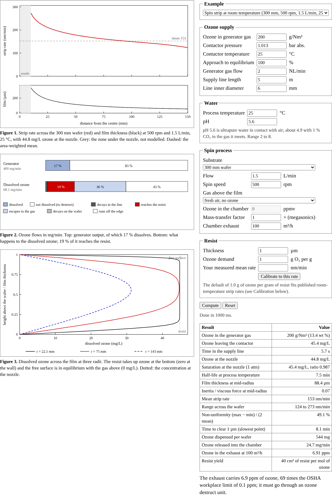
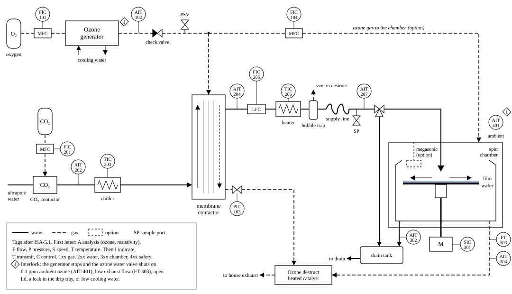
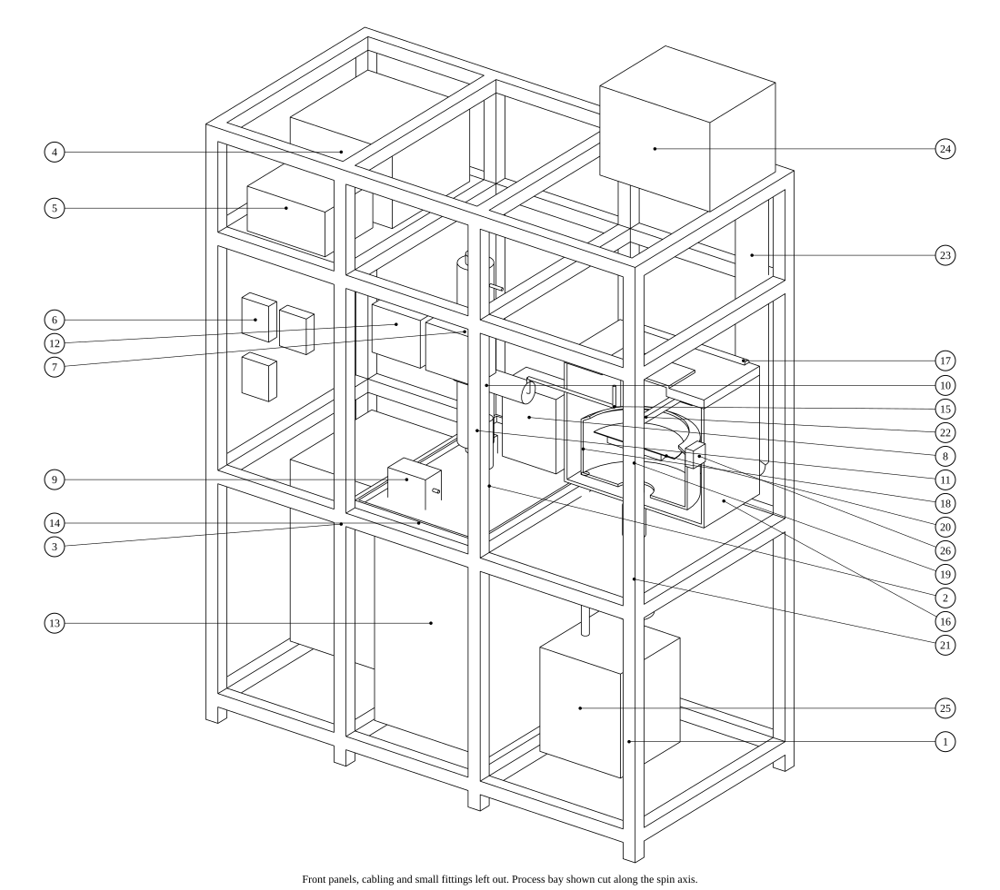
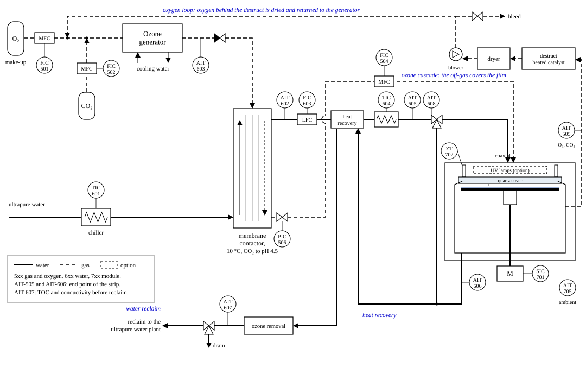
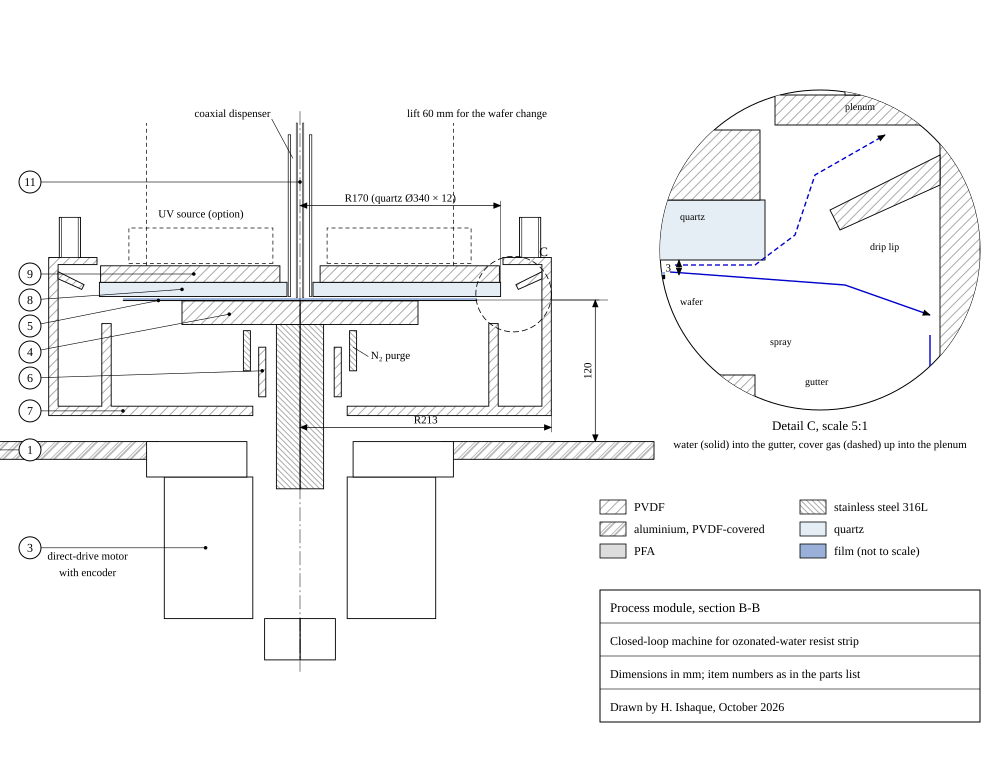

# Ozone wafer cleaning

A process model of ozonated water (DIO3) for photoresist removal on a spinning wafer, checked
against published measurements, with a test rig to measure it and the design of a closed-loop
machine that uses it. The model follows the ozone from the generator gas into the water, through
the supply line and across the liquid film into the resist, and gives the strip rate across the
wafer, the uniformity, the time to clear and where the ozone goes. It comes as a Python package
(`dio3`) with tests, and as a single-page browser program with no server and no libraries that
uses the same equations.

**Open the program:** https://hashimishaque.com/ozone-wafer-cleaning/



## About the data

This is a theoretical model built from published equations and data, each cited below. The
checks compare it with exact solutions and with the values it was built from; the validation
compares it with published measurements that were not used to build it. How much resist a given
amount of ozone removes depends on the resist, so that one number is calibrated against published
strip rates and can be calibrated to your own measurements. No unpublished data, and no data from
any research centre or company process, were used. The test rig and the machine are designs;
neither has been built.

## What it covers

**Chemistry**
- Ozone solubility from Henry's law: 1.0 × 10⁻⁴ mol m⁻³ Pa⁻¹ at 25 °C with d ln H / d(1/T) = 2800 K
  (Burkholder et al. 2019, listed by Sander 2023).
- Self-decomposition: −d[O₃]/dt = k₁[O₃] + k₂[O₃]², with the slow first-order decay in acid from
  De Smedt et al. (2002) and the hydroxide-driven decay near neutral pH from Ershov and Morozov
  (2009), with their activation energies.
- The Staehelin-Hoigné-Bühler radical mechanism (rate constants compiled by Lesko 2004, two from
  Buxton et al. 1988), to show why pH, carbonate and hydrogen peroxide change the life of ozone.
- The pH of ultrapure water holding CO₂, and the resistivity that goes with it.

**Engineering**
- Generator gas and contactor (any fraction of equilibrium, any pressure), decay in the supply
  line, and supersaturation when the water is warmer at the nozzle than in the contactor.
- The film on the spinning wafer, h = (3νQ / 2πω²r²)^(1/3) (Emslie, Bonner and Peck 1958).
- Ozone transport across the film, marched outward from the nozzle in 48 stream tubes, with decay
  in the water, uptake at the resist and exchange with the gas above (fresh air, or a chamber
  filled with process gas). The ozone balance closes to rounding error.
- A mass-transfer factor for megasonic agitation.
- A second ring of nozzles that adds fresh ozone water at a set radius (Python package only).

**Process**
- Strip-rate profile, mean, range and non-uniformity; time to clear the slowest point.
- Ozone used per wafer and the share that reaches the resist; ozone released into the chamber
  and its concentration in the exhaust, next to the OSHA and NIOSH limits for workplace air.
- The process window over temperature and spin speed, and the temperature at which the strip
  rate peaks when ozone is dissolved cold and heated on the way.

**Validation** (`validation.py`; Figure 7 and two tables on the page)
- Solubility against nine measurements of Henry's constant since 1950 (Sander 2023): the value
  used is 0.91 times the median measurement, and eight of the nine lie within 20 %.
- Half-life against the values tool makers quote (MKS data sheet; ACM, US 12,334,367; Sumco,
  US 7,678,200). The rate law agrees at 5 to 10 mg/L, but at 90 mg/L and pH 7 it gives under a
  minute against about 15 min; with CO₂ to pH 4.5 it gives 13 min. This is the largest open
  question, and stage 1 of the test plan measures it.
- Strip rate: the yield fitted to two of the three published sources predicts the third within a
  factor of 1.6.
- Heated wafer: the NEC patent reports 2 and 3 times the rate; the model with the whole film at
  60 and 80 °C gives 1.8 and 2.2 times.
- Film: direct simulation and experiments (Stafford et al. 2024) confirm the mean thickness and
  show waves at these settings, so the smooth-film transfer is a lower bound.
- Every input checked against its source. This corrected the Dussault calibration point (a
  negative resist with megasonics) and found two rate constants of the radical mechanism above the
  values of Buxton et al. (1988); with their values the half-life at pH 7 falls from 8.4 to 6.6 min.
- Recent work: 24 papers, theses and patents from 2016 to 2026, and what each is used for.

**Test rig**
- The piping and instruments of a bench that measures every number the model uses or predicts,
  with its parts, materials and safety interlocks.
- Sizing for the current settings: the ozone made, dissolved and sent to the destruct; the ozone
  in the exhaust and in the drain, with and without resist; the UV absorbance at the nozzle; the
  resistivity that goes with the pH; the decay time; when to stop a partial strip.
- A test plan in four stages, and a two-level design of 16 runs plus 4 centre points for the strip
  tests, with the model's prediction for each run.
- The mechanical design: a frame of aluminium profile, 1600 × 800 × 2000 mm in three bays (gas,
  water, process), as a parametric CAD model with STEP files; an isometric view, a general
  arrangement, a cut-away of the spin module and Section A-A, with a parts list of 27 items.
- Why each part is built the way it is, against the alternative, and what is new in the rig.





**A closed-loop machine**
- Four loops close the losses of the open rig: the off-gas of the contactor is fed under a quartz
  cover 3 mm above the wafer, so the film is covered by ozone-rich gas instead of room air; the
  oxygen behind the destruct unit is dried and returned to the generator; the warm drain heats
  the ozone water on its way to the nozzle; and the drain goes back to the ultrapure-water plant
  after ozone removal and a TOC check. The water is chilled to 10 °C before the contactor, CO₂
  brings it to pH 4.5, and the line to the nozzle is short.
- The model chooses the operating point from 1800 settings under limits for bubbles, film
  thickness and cover gas: 30 °C, 1600 rpm, 2 L/min, generator gas of 300 g/Nm³ at 1 NL/min.
- The piping and instruments, a CAD model of the process module with a STEP file, a cut-away and
  Section B-B with a detail of the rim, a parts list, the risks and how the rig tests them, the
  prior art, and what is new.

| Per wafer | Test rig, open | Closed-loop machine |
|---|---|---|
| Time to clear 1 µm of resist (min) | 8.1 | 2.3 |
| Water (L) | 12.9 | 5.3 |
| Ozone made (g) | 3.2 | 0.68 |
| Oxygen bought (NL) | 16 | 0.9 |
| Electricity (kWh) | 0.22 | 0.12 (0.074 with the chiller as a heat pump) |
| Exhaust air (m³) | 13.5 | 0.38 |
| Share of the ozone made that reaches the resist | 3 % | 18 % |

The numbers come from the model and the assumptions listed on the page (`machine.py`). For
comparison, single-wafer SPM uses about 0.45 L of H₂O₂ and 2.4 L of H₂SO₄ per wafer (ACM Research).





## Python

Needs Python 3.9 or newer with NumPy and SciPy (Matplotlib for the example, pytest for the tests).

```
python3 -m dio3                                         # the default room-temperature process
python3 -m dio3 --t 70 --rpm 1200 --flow 0.5 --ambient "process gas"
python3 -m dio3 --help
python3 -m pytest -q                                    # 20 checks
python3 examples/process_window.py                      # process_window.png
```

```python
from dio3 import Process, simulate

r = simulate(Process(T=298.15, rpm=500, flow_lpm=1.5))
print(r['strip_mean'] * 6e10, 'nm/min')     # m/s to nm/min
print(r['budget'])                          # where the dissolved ozone goes, mol/s

# a second ring of nozzles at 50 mm with 1 L/min of the same ozone water
r = simulate(Process(T=303.15, rpm=1600, flow_lpm=2.0, ring_radius=0.05, ring_flow_lpm=1.0))

from dio3.carbonate import resistivity_co2, co2_pressure_for_ph
print(resistivity_co2(4.9), 'MOhm cm')      # resistivity meter reading for pH 4.9 set with CO2
print(co2_pressure_for_ph(4.9), 'Pa')       # CO2 partial pressure that gives that pH
```

The page and its figures:

```
python3 make_data.py          # checks.json, mechanism.json
python3 validation.py         # validation.json, validation.svg (Figure 7)
python3 rig.py                # rig.svg (Figure 8)
python3 machine_pid.py        # machine_pid.svg (Figure 13)
python3 machine.py            # machine.json, machine_space.svg (Figure 14); takes about 1.5 min
python3 build.py              # index.html
```

The CAD model needs CadQuery (`pip install cadquery`). The STEP files open in FreeCAD and in
other CAD programs.

```
python3 cad/rig_cad.py        # cad/rig.step, cad/spin_module.step; Figures 9 to 11
python3 cad/drawings.py       # Figure 12, Section A-A through the spin module of the rig
python3 cad/module_cad.py     # cad/module.step; Figure 15
python3 cad/module_section.py # Figure 16, Section B-B through the process module of the machine
```

## Checks

`python3 -m pytest -q` runs these, and the page shows them with their numbers:

| Check | Expected | This model |
|---|---|---|
| Ozone water from 9 wt % ozone gas at 1 atm and 25 °C (mg/L) | 10 to 30 typical (Abe et al. 2003) | 30.1 |
| Ozone solubility at 5 °C divided by that at 25 °C | 1.85 (NEC patent US 6,559,064) | 1.96 |
| pH of ultrapure water in contact with air | about 5.6 (De Smedt et al. 2002) | 5.60 |
| Resistivity of ultrapure water at 25 °C (MΩ cm) | 18.19 (Light et al. 2005) | 18.23 |
| Ozone half-life at pH 2.5, room temperature, 10 mg/L (h) | 3 to 4 (De Smedt et al. 2002) | 3.1 |
| Half-life at pH 7, 20 °C: rate law and radical mechanism (min) | 11.6 (rate law) | 7.4 (mechanism, air-level carbonate) |
| Film thickness at 75 mm, 1.5 L/min, 500 rpm, 25 °C (µm) | 88.5 (Lepehin and Riabchuk) | 88.4 |
| Well-mixed film with first-order decay: ozone left at the edge | 0.995337 (exact) | 0.995335 |
| Mean ozone flux to the resist, normal grid against 4 times finer grid | same | −0.1 % |
| Ozone balance on the wafer | 0 | 5 × 10⁻¹⁶ |
| Strip rate at 100, 500 and 1000 rpm (nm/min) | rises with spin speed | 51, 102, 133 |
| Strip rate at 10, 25 and 60 °C with the same 30 ppm (nm/min) | rises with temperature | 76, 102, 159 |
| Strip rate at 60 ppm divided by that at 30 ppm | about 2 (transport-limited) | 2.000 |

The tests also check that a second ring of nozzles conserves ozone and that a bare wafer takes no
ozone. Water density and viscosity are checked against the CRC Handbook, the ozone diffusivity
against the Stokes-Einstein relation, and the browser version against the Python package
(`python3 -m tests.golden && node crosscheck.js`; they agree to about 10⁻¹⁵).

## Calibration

The strip rate is the ozone flux into the resist multiplied by the resist volume removed per mole
of ozone. Three published room-temperature results give that yield once the settings they do not
report are assumed (`dio3/calibration.py`):

| Source | Published | Implied g of ozone per g of resist |
|---|---|---|
| Abe et al. (2003) | about 100 nm/min with 10 to 30 ppm | 0.76 |
| NEC patent US 6,559,064 | about 300 nm/min with 100 ppm on a rotating wafer | 1.05 to 1.62 |
| Dussault, Fittkau and Gottschalk (2014) | 279 nm/min for a negative resist at 80 ppm, 20 °C, 110 rpm and 1.4 L/min with megasonics, the water fed through a radial manifold; the megasonic gain of over 65 % taken out of it was measured on a positive resist | 0.83 |

The default is 1.0 g/g. `calibration.fit_yield()` and the Resist box on the page calibrate it to
your own measurements.

## Files

| File | Contents |
|---|---|
| `dio3/` | The Python package: `properties.py` (water and ozone), `decomposition.py` (rate law), `mechanism.py` (radical chain), `carbonate.py` (pH and resistivity with CO₂), `supply.py`, `film.py` (film flow and transport), `resist.py`, `process.py`, `calibration.py`, and the command line in `__main__.py` |
| `tests/` | The checks (`test_model.py`) and the cases for the browser cross-check (`golden.py`, `golden.json`, `golden_functions.json`) |
| `examples/process_window.py` | The process window with Matplotlib |
| `model.js` | The browser version of the model |
| `template.html` | The page around it: text, figures and form |
| `make_data.py` | Writes `checks.json` and `mechanism.json`, which the page shows |
| `validation.py` | The validation against published measurements: writes `validation.json` (the inputs table) and `validation.svg` (Figure 7) |
| `rig.py`, `rig.svg` | Draws Figure 8, the piping and instruments of the test rig |
| `machine.py` | The closed-loop machine: the search for the operating point, the use per wafer, the steps and the options; writes `machine.json` and `machine_space.svg` (Figure 14) |
| `machine_pid.py`, `machine_pid.svg` | Draws Figure 13, the piping and instruments of the machine |
| `cad/` | The CAD model (CadQuery): `rig_cad.py` (the test rig; `rig.step`, `spin_module.step`, Figures 9 to 11), `drawings.py` (Figure 12), `module_cad.py` (the process module of the machine; `module.step`, Figure 15), `module_section.py` (Figure 16), and the drawings as SVG |
| `build.py` | Puts the page together: `python3 build.py` writes `index.html` |
| `crosscheck.js` | Compares `model.js` with the Python package |
| `screenshot.png`, `social.png` | Screenshot for this README, and the preview image shown when the page is shared |

## Limitations

- The film is a steady, smooth, laminar film; inertia near the centre and waves are left out, and
  the zone under the nozzle (r < 10 mm) is not modelled.
- Water and wafer are at one temperature; a heated wafer under cooler water is not modelled.
- The nozzle is fixed at the centre; swinging nozzles, sprays and immersion are not modelled.
- The decay law covers pH 2 to 8 and about 10 to 70 °C; organic acids from the resist, which can
  scavenge radicals, are ignored. At the 80 to 100 mg/L used in tools it gives much shorter
  half-lives at pH 7 than tool makers quote (Figure 7b).
- One calibrated yield describes the resist; implanted or hard-baked resists strip differently,
  and no surface reaction limit is applied by default.
- The contactor efficiency is set by hand; bubble formation in supersaturated water is flagged
  but not modelled. UV-assisted ozone and peroxide chemistry is not included.
- The closed-loop machine is a design. Its numbers come from the model and from the assumptions
  listed with it; nothing of it has been built or tested. The second ring of nozzles is in the
  Python package only.

See `ROADMAP.md` for what comes next.

## References

- Abe, H., Iwamoto, H., Toshima, T., Iino, T. and Gale, G. W. (2003). Novel photoresist stripping using ozone/vaporized water mixture. IEEE Trans. Semicond. Manuf. 16, 401-408.
- Aoune, A. and Ramshaw, C. (1999). Process intensification: heat and mass transfer characteristics of liquid films on rotating discs. Int. J. Heat Mass Transfer 42, 2543-2556.
- Applied Materials. US Patent 11,114,350 B2 (priority 2019, granted 2021): photomask resist removed by a plasma of water vapour, then of O₃ or O₂.
- Bader, H. and Hoigné, J. (1981). Determination of ozone in water by the indigo method. Water Res. 15, 449-456.
- Bang, B., Youn, J. and Kwon, K. (Semes). Dissolved ozone removal unit, apparatus for treating substrate, method of removing dissolved ozone, and method of cleaning substrate. US Patent 10,453,672 B2 (priority 2015, granted 2019).
- Bergman, E. J. and Hess, M. P. Apparatus and method for processing the surface of a workpiece with ozone. US Patent 6,267,125 B1 (priority 1997).
- Bhatelia, T. J., Utikar, R. P., Pareek, V. K. and Tade, M. O. (2009). Characterizing liquid film thickness in spinning disc reactors. 7th Int. Conf. on CFD in the Minerals and Process Industries, Melbourne. Cites Lepehin and Riabchuk (1975) and Espig and Hoyle (1965).
- Bühler, R. E., Staehelin, J. and Hoigné, J. (1984). Ozone decomposition in water studied by pulse radiolysis. 1. HO₂/O₂⁻ and HO₃/O₃⁻ as intermediates. J. Phys. Chem. 88, 2560-2564.
- Burkholder, J. B. et al. (2019). Chemical kinetics and photochemical data for use in atmospheric studies, Evaluation No. 19. JPL Publication 19-5.
- Burns, J. R. and Jachuck, R. J. J. (2005). Determination of liquid-solid mass transfer coefficients for a spinning disc reactor using a limiting current technique. Int. J. Heat Mass Transfer 48, 2540-2547.
- Buxton, G. V., Greenstock, C. L., Helman, W. P. and Ross, A. B. (1988). Critical review of rate constants for reactions of hydrated electrons, hydrogen atoms and hydroxyl radicals in aqueous solution. J. Phys. Chem. Ref. Data 17, 513-886.
- Chen, F., Lei, H., Zhang, X., Wang, W. et al. (ACM Research and Shanghai Huali Microelectronics). High performance eco-friendly SPM cleaning technology using an integrated bench single wafer cleaning system (2019 or later). [acmr.com](https://www.acmr.com/wp-content/uploads/260_High-Performance-Eco-Friendly-SPM-Cleaning-Technology-using-Integrated-Bench-Single-Wafer-Cleaning-System-20.10.04.pdf)
- Chen, J.-W. (2002). The study of photoresist removal mechanism by ozone. MSc thesis, National Chiao Tung University (in Chinese).
- De Smedt, F., De Gendt, S., Claes, M., Heyns, M. M., Vankerckhoven, H. and Vinckier, C. (2002). The increasing importance of the use of ozone in the microelectronics industry. Ozone Sci. Eng. 24, 379-390.
- Dussault, D., Fittkau, J. and Gottschalk, C. (2014). Megasonic enhanced photoresist strip with DiO₃. Solid State Phenomena 219, 187-190.
- Dussault, D., Weinhart, M., Zenger, T. and Eichinger, I. (2018). Megasonic enhanced photo resist removal using unique solvent free phase-fluids on an advanced single wafer resist processing system. AiMES 2018, Cancún.
- Emslie, A. G., Bonner, F. T. and Peck, L. G. (1958). Flow of a viscous liquid on a rotating disk. J. Appl. Phys. 29, 858-862.
- Ershov, B. G. and Morozov, P. A. (2009). The kinetics of ozone decomposition in water, the influence of pH and temperature. Russ. J. Phys. Chem. A 83, 1295-1299.
- European Union. Regulation (EU) 2024/1849 amending Regulation (EU) 2017/852 on mercury; Fraunhofer IOSB-AST, Mercury ban 2027 (information sheet on mercury UV lamps).
- Gottschalk, C. and Schweckendiek, J. (2004). Using dissolved ozone in semiconductor cleaning applications. MICRO, March 2004.
- Gurol, M. D. and Singer, P. C. (1982). Kinetics of ozone decomposition: a dynamic approach. Environ. Sci. Technol. 16, 377-383.
- Haynes, W. M. (ed.) (2016). CRC Handbook of Chemistry and Physics, 97th ed. CRC Press.
- Heit, G. and Braun, A. M. (1997). VUV-photolysis of aqueous systems: spatial differentiation between volumes of primary and secondary reactions. Water Sci. Technol. 35, 25-30.
- ISA (2009). ANSI/ISA-5.1-2009, Instrumentation symbols and identification. International Society of Automation.
- Johnson, P. N. and Davis, R. A. (1996). Diffusivity of ozone in water. J. Chem. Eng. Data 41, 1485-1487.
- Kawaguchi, M. N., Zhu, J., Fischer, C., Man, X., Bandarapu, B. and Kon, S. (2017). Thermally activated gas-phase chemical reactions in a single-wafer wet clean process. 232nd ECS Meeting, National Harbor.
- Kell, G. S. (1975). Density, thermal expansivity, and compressibility of liquid water from 0 to 150 °C. J. Chem. Eng. Data 20, 97-105.
- Kestin, J., Sokolov, M. and Wakeham, W. A. (1978). Viscosity of liquid water in the range −8 °C to 150 °C. J. Phys. Chem. Ref. Data 7, 941-948.
- Lesko, T. M. (2004). Chemical effects of acoustic cavitation. PhD thesis, California Institute of Technology, chapter 5, table 1.
- Levanov, A. V., Isaikina, O. Ya., Tyutyunnik, A. N., Antipenko, E. E. and Lunin, V. V. (2016). Molar absorption coefficient of ozone in aqueous solutions. J. Anal. Chem. 71, 549-553.
- Light, T. S., Licht, S., Bevilacqua, A. C. and Morash, K. R. (2005). The fundamental conductivity and resistivity of water. Electrochem. Solid-State Lett. 8, E16-E19.
- Linde. OZORA oxygen recovery unit, white paper.
- Liou, H.-T. Ozone on-line injection, reuse, and destruction system. US Patent 7,501,055 B2 (priority 2004).
- Liu, Y., Zhou, L., Zhang, L. and Hu, J. (2026). Ozone micro-nanobubbles: properties, effects, and applications. Water 18, 1189.
- Lo, J.-Y., Chen, Y.-H., Chuang, J.-P., Chiu, C.-J., Weng, P.-C. and Chen, K.-H. (WIN Semiconductors) (2021). A novel environment-protecting technique for photoresist strip, metal lift-off, and etching byproduct removal. CS MANTECH 2021.
- McCoy, O. (2022). Five things we learned about the UPW-energy relationship at UPM 2022. UltraFacility.
- Meeuwse, M., van der Schaaf, J. and Schouten, J. C. (2010). Liquid-solid mass transfer in a rotor-stator spinning disc reactor. ISCRE 21, Philadelphia.
- MKS Instruments (2022). Ozone Conversion, data sheet, rev. 10/22.
- Morioka, T. (SCREEN Holdings). Substrate processing apparatus and gap washing method. US Patent 10,141,206 B2 (priority 2016, granted 2018).
- NIOSH Pocket Guide to Chemical Hazards: Ozone. [cdc.gov/niosh/npg/npgd0476.html](https://www.cdc.gov/niosh/npg/npgd0476.html)
- Oxidation Technologies. Ozone production from corona discharge. [oxidationtech.com](https://www.oxidationtech.com/blog/?p=5428)
- Proc. SPIE 6283, 62830B (2006). Sulfate-free photomask cleaning technology.
- Quickenden, T. I. and Irvin, J. A. (1980). The ultraviolet absorption spectrum of liquid water. J. Chem. Phys. 72, 4416-4428.
- Sander, R. (2023). Compilation of Henry's law constants (version 5.0.0) for water as solvent. Atmos. Chem. Phys. 23, 10901-12440.
- SCREEN Holdings. Resist removing method and resist removing apparatus. US Patent 11,342,162 B2 (priority 2017, granted 2022).
- SCREEN Holdings. US Patent 11,958,087 B2 (priority 2021, granted 2024); Suzuki, K. and Inaba, M. US Patent 12,397,326 B2 (priority 2021, granted 2025): substrate treatment with sulfuric acid and ozone gas.
- Seiwert, J. H., Brammer, U. A., Blacha, M. and Schnaiter, G. J. (MKS Instruments). Pressure-less ozonated DI-water (DIO₃) recirculation reclaim system. US Patent 9,597,613 B2 (priority 2012, granted 2017).
- SEMI S2. Environmental, health, and safety guideline for semiconductor manufacturing equipment. SEMI.
- Shimizu, Y. (NEC). Method and apparatus for removing photoresist on semiconductor wafer. US Patent 6,559,064 B1 (priority 1999).
- Shirai, Y., Sakai, T. and Jizaimaru, T. (Tohoku University and Nomura Micro Science). Method for producing ozone water. US Patent 11,295,947 B2 (granted 2022); Method of producing heated ozone water, heated ozone water, and semiconductor wafer-cleaning liquid. US Patent 11,817,309 B2 (granted 2023; priority of both 2018).
- Solid State Phenomena 346, 296-301 (2023). Reduction of process chemicals and energy use in single-wafer process applications.
- Staehelin, J. and Hoigné, J. (1982). Decomposition of ozone in water: rate of initiation by hydroxide ions and hydrogen peroxide. Environ. Sci. Technol. 16, 676-681.
- Stafford, Uzo, Piccoli, Petit and Matar (2024). Thin film flow over a spinning disc: experiments and direct numerical simulations. arXiv:2412.12730.
- Stumm, W. and Morgan, J. J. (1996). Aquatic Chemistry, 3rd ed. Wiley.
- Sumco, Echo Giken and Chlorine Engineers. US Patent 7,678,200 (priority 2002): ozone water for cleaning; half-life of ozone in pure water 10 to 30 min.
- SUSS MicroTec Photomask Equipment (Dattilo, Dietze and Singh). US Patent 11,358,172 B2 (priority 2015; published as US 2017/0087585 A1, granted 2022): substrate treatment with an aqueous medium exposed to UV light.
- Takahashi, M., Ishikawa, H., Asano, T. and Horibe, H. (2012). Effect of microbubbles on ozonized water for photoresist removal. J. Phys. Chem. C 116, 12578-12583.
- Yamamoto, M., Taki, T., Sunada, T., Shikama, T., Nagaoka, S., Umemoto, H. and Horibe, H. (2018). Removal of polymers for KrF and ArF photoresist using hydrogen radicals containing a small amount of oxidizing radicals. J. Photopolym. Sci. Technol. 31, 419-424.
- Zhang, X., Wang, W., Chen, F. et al. (ACM Research (Shanghai)). Method and apparatus for removing particles or photoresist on substrates. US Patent 12,334,367 B2 (priority 2020, granted 2025).
- Zhao, K. (2020). Dynamics of thin liquid films over a spinning disk. PhD thesis, Imperial College London.
- Zhou, F., Zhang, X., Liu, C. and Yang, S. (2020). Stripping process development using SAPS megasonic technology. ICEPT 2020.

## License

The code is MIT licensed, see `LICENSE`. The literature values are taken from the sources above;
please cite them if you use them.
