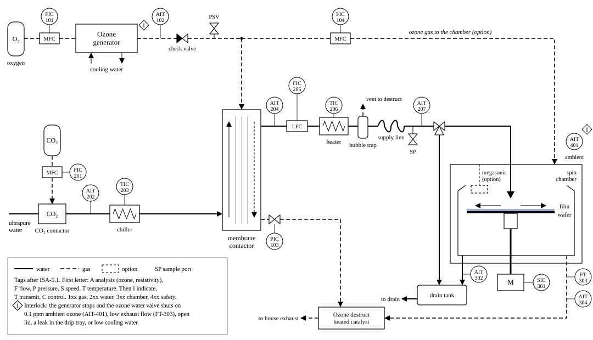
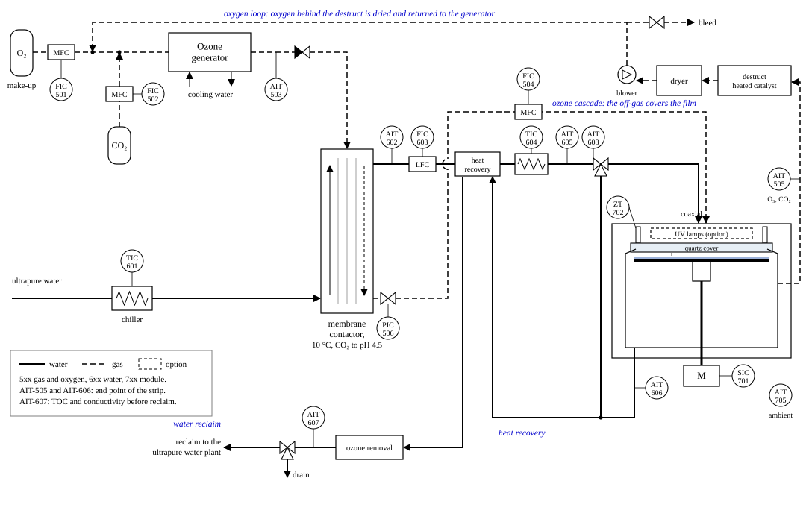
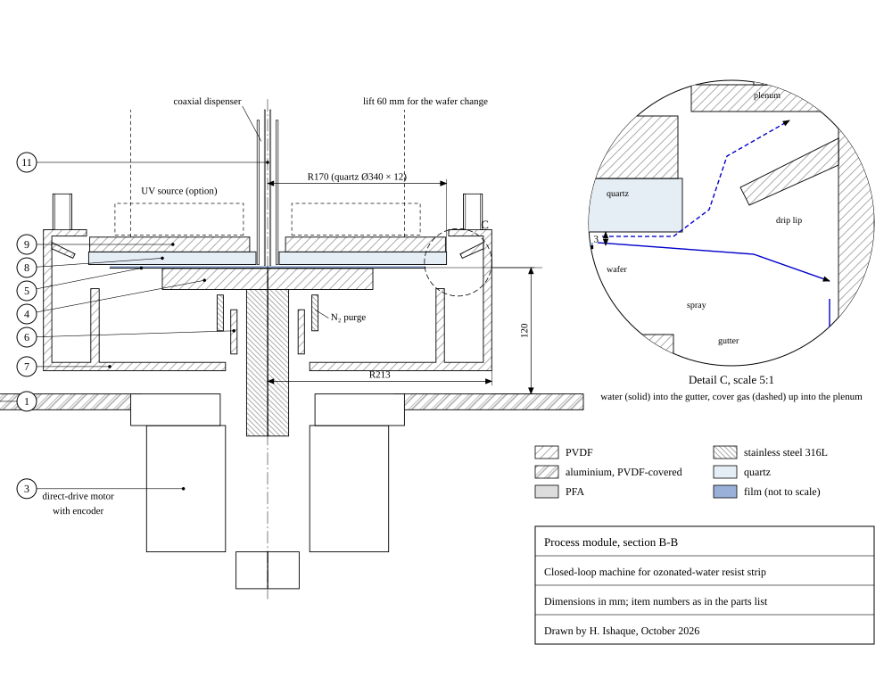

# Handbook: closed-loop ozone-water resist strip

Hashim Ishaque, October 2026

## How to read this handbook

This handbook explains the project from the ground up: why it exists, how each part works and how every number is calculated.

Three rules hold everywhere:

- Every number is either a model result or a published value. Nothing has been built or measured yet.
- "Open process" means the baseline: ozone water on a spinning wafer under room air, as on the test rig. "Closed loop" or "the machine" means the new design.
- Results are for 1 µm of resist on a 300 mm wafer, plus a 30 s rinse.

| Unit | Meaning |
| --- | --- |
| mg/L | Milligrams of dissolved ozone per litre of water; the same as ppm by weight |
| g/Nm³ | Grams of ozone per cubic metre of gas at 0 °C and 1 atm ("normal" conditions) |
| NL, NL/min | A litre of gas at normal conditions; gas flow in normal litres per minute |
| % by volume | Share of the molecules in a gas; 300 g/Nm³ of ozone in oxygen is 14 % by volume |
| nm/min | Strip rate: nanometres of resist removed per minute (1000 nm = 1 µm) |
| µm | Micrometre, a thousandth of a millimetre; used for films and resist |
| kWh | Kilowatt hour, 3.6 MJ |

The order is first why, then how: the physics, the equations, the checks, the rig and the machine. Then come the numbers and how each is calculated, the improvements, the risks and the costs, and a glossary.

## Why: the problem with resist strip today

An open ozone-water strip puts only about 3 % of the ozone it makes into the resist. The closed-loop design raises that to about 18 % and strips 3.5 times faster, in the model.

### What resist strip is

Photoresist is a light-sensitive polymer film, about 1 µm thick here. In lithography it works as a stencil: light writes a pattern into it, then etching or ion implantation acts through the openings. Afterwards the resist must be removed completely, without harming the layers below and without leaving residue or particles. That step is the resist strip, and a wafer goes through it many times, once for every patterned layer.

### How fabs strip resist today

| Method | How it works | Strength | Weakness |
| --- | --- | --- | --- |
| SPM (sulfuric acid and hydrogen peroxide, "piranha") | A hot mixture, for example 4:1 at about 120 °C, oxidises the resist | Fast; removes almost everything, including implanted resist | About 2.4 L of acid and 0.45 L of peroxide per wafer in single-wafer tools; fumes, exhaust and waste treatment; sulfate residues can leave haze on photomasks |
| Plasma ashing | An oxygen plasma burns the resist in a vacuum chamber; a wet clean follows | Fast and dry | A separate vacuum tool; can damage sensitive layers; the residue still needs a wet step |
| Solvent strip | Organic solvents swell or dissolve the resist | Gentle | Hazardous solvents to buy and dispose of |
| Ozone water (DIO₃) | Ozone dissolved in ultrapure water oxidises the resist; only oxygen, water and CO₂ remain | No acid and no solvent; little waste | Slow: about 100 nm/min at 20 mg/L and room temperature; weak on the hardened crust of implanted resist |

The SPM volumes come from savings that [ACM Research reports for 2000 wafers a day](https://www.acmr.com/wp-content/uploads/260_High-Performance-Eco-Friendly-SPM-Cleaning-Technology-using-Integrated-Bench-Single-Wafer-Cleaning-System-20.10.04.pdf). The ozone-water rate comes from Abe et al. (2003), IEEE Trans. Semicond. Manuf. 16, 401.

### What an open ozone process wastes

In the model of the open process, 83 % of the ozone never dissolves: it goes from the dissolver straight to the destruct unit. Of the ozone that does dissolve, more than a third escapes from the film into the room air, and more than 40 % flies off the wafer edge into the drain. The chamber needs about 100 m³/h of exhaust, and the oxygen, the water and the heat are all used once. Section "The numbers" shows the full split.

### Why it matters now

- **Cost and waste.** Acid, peroxide and their treatment are the biggest running cost of SPM, and fabs have targets to cut them.
- **Exhaust and energy.** Conditioned exhaust air is expensive, and an open chamber needs a lot of it.
- **Mercury.** Mercury UV lamps are being phased out in the EU (Regulation (EU) 2024/1849), which pushes UV-assisted processes towards excimer lamps and LEDs.
- **The market.** SUSS launched its GreenTec Solutions line and the GT200 on 1 October 2026: a 200 mm cleaning and stripping platform that "eliminates hazardous acids and organic solvents", with a 300 mm high-volume platform planned for 2027 ([press release](https://www.finanzwire.com/press-release/suss-enters-wafer-cleaning-market-with-launch-of-greentec-solutions-product-line-and-first-gt200-system-CXCJoniUbBT)).

### The idea in one paragraph

Close the loops. The ozone that did not dissolve is fed into a closed 3 mm gap over the wafer instead of being destroyed. The oxygen behind the destruct unit goes back to the generator. The warm drain heats the fresh ozone water, and the drain water returns to the ultrapure-water plant. On top of that, ozone is dissolved cold with a little CO₂, the hot line to the nozzle is short, and the wafer spins faster.

## How ozone water strips resist, in plain words

Ozone passes several stages between the generator and the resist, and some of it is lost at each one. Every design choice in the machine aims to make one of those losses smaller. The numbers below are for the machine's design point.

1. **Making ozone.** A generator passes oxygen through an electric discharge, and part of the O₂ recombines as O₃. At 300 g/Nm³ the gas is 14 % ozone by volume and the rest is oxygen. The model counts 12 Wh of electricity per gram of ozone; the theoretical minimum is 0.82 Wh/g.
2. **Dissolving it.** Water takes up ozone in proportion to the ozone's partial pressure in the gas; this is Henry's law. Cold water holds more, about 1.6 times as much at 10 °C as at 25 °C. In a membrane contactor, gas and water flow on opposite sides of a PTFE or PFA membrane, so the ozone dissolves without bubbles; at the design point the water leaves with 101 mg/L.
3. **Keeping it alive.** Dissolved ozone falls apart into oxygen by itself. Hydroxide ions (OH⁻) drive most of that decay, so it runs faster at higher pH and at higher temperature. A little CO₂ in the gas makes the water slightly acidic, about pH 4.5, which slows the decay and leaves no residue on the wafer.
4. **Warm, but no bubbles.** The water is dissolved cold at 10 °C and heated to 30 °C only just before the nozzle, because warm water strips faster. Warm water holds less ozone, so after heating it carries 1.7 times what it could hold in balance with the generator gas: it is supersaturated. The design keeps that ratio at or below 2, so that no bubbles form, and the hot line is so short (0.4 s) that almost no ozone decays in it.
5. **The spinning film.** The nozzle drops the water at the centre of the wafer, and the spin flings it outward as a thin film. The film gets thinner with speed and with radius: at 1600 rpm and 2 L/min it is 43 µm thick at mid-radius and 27 µm at the edge. The water crosses the whole wafer in less than a tenth of a second.
6. **Reaching the resist.** The film flows in smooth layers, so ozone reaches the resist only by diffusion across the film. The resist reacts with every ozone molecule that arrives, so the strip rate is set by how fast ozone gets there; this is called transport-limited. A thinner film means a shorter path and a faster strip, and about 1 g of ozone removes 1 g of resist.
7. **Escaping to the gas.** The top of the film touches the gas above it. Where the film holds more ozone than is in balance with that gas, ozone escapes upward. Under room air the loss is large; under the 5 % ozone gas of the machine, 36 % of the dissolved ozone escapes instead of 46 %.
8. **Leaving at the edge.** Ozone still in the water when it leaves the edge goes to the drain: 38 % of the dissolved ozone in the machine. That water can be freed of ozone and returned to the ultrapure-water plant.
9. **Uneven stripping.** The centre gets fresh water, while the water reaching the edge has already lost ozone to the resist and the gas. So the centre strips at 1168 nm/min and the edge at only 439 nm/min. The wafer is finished only when its slowest point is clear, so the edge sets the time: 1000 nm ÷ 439 nm/min = 2.28 min.
10. **Knowing when it is done.** While resist remains it consumes ozone, so the drain carries 38 mg/L. When the resist is gone the drain rises to 63 mg/L, and the CO₂ made from the resist stops. Either signal can end the step at once instead of after a fixed safety margin.

One comparison explains why so much ozone leaves at the edge. Diffusing across 27 µm of water takes ozone about 0.35 s, but the water stays on the wafer for only 0.09 s. Most of the ozone never reaches the bottom of the film before the water flies off.

## The governing equations and how they are solved

The model solves one partial differential equation: ozone in the spinning film, carried outward by the flow, diffusing across the film and decaying everywhere. It is solved between two boundary conditions: the resist takes up every molecule that arrives, and the film surface stays in balance with the gas above. Everything else, from the supply and the gas to the use per wafer, is algebra around that equation. The code is the Python package `dio3` (about 940 lines), with a JavaScript copy for the web page that is checked against it.

### 1. The generator gas: ideal gas law

A mole of gas fills Vₘ = RT₀/p₀ = 22.414 L at 0 °C and 1 atm. The ozone mole fraction y follows from the concentration c\_g in g/Nm³:

```latex
y = \frac{c_g\, V_m}{M_{O_3}} = \frac{300\ \mathrm{g\,m^{-3}} \times 0.022414\ \mathrm{m^3\,mol^{-1}}}{47.998\ \mathrm{g\,mol^{-1}}} = 0.140
```

### 2. Dissolving: Henry's law

At equilibrium the dissolved ozone is proportional to its partial pressure. The constant falls with temperature by the van 't Hoff relation:

```latex
c_{eq} = H(T)\, y\, p, \qquad H(T) = H_{298} \exp\left[ B \left( \frac{1}{T} - \frac{1}{298.15\ \mathrm{K}} \right) \right]
```

The model uses H₂₉₈ = 1.0 × 10⁻⁴ mol m⁻³ Pa⁻¹ and B = 2800 K, from the evaluation of Burkholder et al. (2019) as listed by Sander (2023). A membrane contactor reaches a share η of equilibrium, its approach, so c\_out = η c\_eq with η = 0.9.

Worked example: at 10 °C, H = 1.645 × 10⁻⁴. Then c\_eq = 1.645 × 10⁻⁴ × 0.140 × 101 325 = 2.335 mol/m³, or 112 mg/L, because 1 mol/m³ of ozone is 48.0 mg/L. With η = 0.9 the water leaves with 101 mg/L.

### 3. Decay: a two-term rate law

```latex
-\frac{dc}{dt} = k_1(T)\, c + k_2(\mathrm{pH}, T)\, c^2
```

- **k₁, slow first-order decay**, which dominates in acid: half-life 3.5 h at 22 °C and activation energy 39.6 kJ/mol (De Smedt et al. 2002).
- **k₂, hydroxide-driven decay**, which dominates near neutral pH: log₁₀ k₂ = −2.66 + 0.49 pH in L mol⁻¹ s⁻¹ at 19 °C, with 76 kJ/mol (Ershov and Morozov 2009). Each pH unit multiplies k₂ by about 3.
- **Temperature**: both follow Arrhenius, k(T) = k(T\_ref) exp\[−(E\_a/R)(1/T − 1/T\_ref)\].

The equation has an exact solution, so the loss in the line needs no numerical step:

```latex
c(t) = \frac{k_1 c_0\, e^{-k_1 t}}{k_1 + k_2 c_0 \left(1 - e^{-k_1 t}\right)}, \qquad t_{1/2} = \frac{1}{k_1} \ln \frac{2 k_1 + k_2 c_0}{k_1 + k_2 c_0}
```

Worked example at pH 4.5 and 30 °C: k₁ = 8.4 × 10⁻⁵ s⁻¹ and k₂ = 1.09 × 10⁻³ m³ mol⁻¹ s⁻¹. The half-life at 101 mg/L is 6.9 min. The line holds 12.6 mL, which 2 L/min passes in 0.38 s, so 0.09 % of the ozone is lost there.

### 4. Supersaturation at the nozzle

```latex
S = \frac{c_{nozzle}}{H(T_{process})\, y\, p}
```

At 30 °C, H = 0.857 × 10⁻⁴ and the saturation value against the generator gas is 58.4 mg/L. So S = 100.8 ÷ 58.4 = 1.73, under the limit of 2.

### 5. The film: thin-film flow on a rotating disc

The film is thin compared with the radius, so the centrifugal force is balanced by viscous shear alone (Emslie, Bonner and Peck 1958). The water sticks to the wafer (u = 0 at z = 0) and the free surface carries no shear. Inertia, the Coriolis force and waves are left out.

```latex
\nu \frac{\partial^2 u}{\partial z^2} = -\omega^2 r \quad\Rightarrow\quad u(r,z) = \frac{\omega^2 r}{\nu} \left( h z - \frac{z^2}{2} \right)
```

The flow through any circle is the whole feed, Q = 2πr ∫₀ʰ u dz = 2πω²r²h³/(3ν). Solved for the thickness:

```latex
h(r) = \left( \frac{3 \nu Q}{2 \pi \omega^2 r^2} \right)^{1/3}
```

Worked example: ν = 8.01 × 10⁻⁷ m²/s at 30 °C, Q = 3.33 × 10⁻⁵ m³/s (2 L/min) and ω = 167.6 rad/s (1600 rpm). Then h = 27.2 µm at r = 150 mm and 43.2 µm at 75 mm. The open process, at 25 °C, 500 rpm and 1.5 L/min, gives 55.7 µm at the edge.

### 6. Ozone in the film: convection, diffusion and reaction

In steady state, ozone is carried outward by the flow, diffuses across the film and decays. Diffusion along the radius is negligible beside the transport by the flow.

```latex
u \frac{\partial c}{\partial r} + w \frac{\partial c}{\partial z} = D \frac{\partial^2 c}{\partial z^2} - k_1 c - k_2 c^2
```

Here w is the small vertical velocity that keeps each streamline at a fixed fraction ζ = z/h of the thickness. The diffusivity is D = 1.1 × 10⁻⁶ exp(−1896 K/T) m²/s (Johnson and Davis 1996), 2.11 × 10⁻⁹ m²/s at 30 °C. Three conditions close the problem:

- **At the resist (z = 0): c = 0.** Every molecule that arrives reacts, so the rate is set by transport. If tests show a slower surface reaction, −D ∂c/∂z = k\_w c with a fitted k\_w replaces it.
- **At the free surface (z = h): c = c\_s = H(T) y\_gas p.** The surface is in balance with the gas above, which is the usual rule for a sparingly soluble gas. Under air y\_gas = 0; under the machine's off-gas y\_gas = 5.07 %, so c\_s = 21.1 mg/L.
- **At the start (r₀ = 5 mm): c = c\_nozzle** across the whole film.

### 7. How the film equation is solved

1. The film is divided into 48 stream tubes at fixed ζ, spaced closer near the wafer and near the surface. From the velocity profile, the share of the flow below ζ is 3(ζ²/2 − ζ³/6), so each tube carries a fixed flow.
2. The solver marches outward in 400 radial steps from 5 mm to the edge, with shorter steps near the start where the concentration changes fastest.
3. At each step, each tube balances ozone carried in and out, diffusion to its neighbours and decay. The bottom tube also loses ozone to the resist, and the top tube exchanges it with the gas.
4. The step is implicit (backward Euler). The c² term makes it non-linear, so Newton iterations solve it, each one a tridiagonal system (Thomas algorithm).
5. The solver books every mole: into the resist, to the gas, decayed, and out at the edge. Inputs equal outputs to rounding error, and one case takes about a second. The 1800-setting search uses 32 tubes and 200 steps to save time.

For tube j at step n, with q\_j its flow per radian, V\_j = r h Δζ\_j its volume per radian and unit radius, and g = rD/(h Δζ) the diffusion conductance between tube centres:

```latex
\frac{q_j}{\Delta r}\left(c_j^{n} - c_j^{n-1}\right) = g_{j-\frac12}\left(c_{j-1}^{n} - c_j^{n}\right) + g_{j+\frac12}\left(c_{j+1}^{n} - c_j^{n}\right) - V_j \left( k_1 c_j^{n} + k_2 \left(c_j^{n}\right)^2 \right)
```

The bottom tube adds −g\_w c₁ with g\_w = rD/(h ζ₁), the uptake by the resist. The top tube adds g\_s (c\_s − c\_N), the exchange with the gas.

### 8. From ozone flux to strip rate

```latex
v(r) = Y N_w(r), \qquad N_w = D \left. \frac{\partial c}{\partial z} \right|_{z=0}, \qquad Y = \frac{M_{O_3}}{\rho_{resist}\, \phi}
```

The yield Y is the resist volume removed per mole of ozone. With φ = 1.0 g of ozone per g of resist (calibrated, section 5) and ρ = 1200 kg/m³, Y = 4.0 × 10⁻⁵ m³/mol. Three results follow from the profile v(r), taken from 10 mm outward:

```latex
t_{clear} = \frac{\delta}{v_{min}}, \qquad U = \frac{v_{max} - v_{min}}{2\, \bar{v}}, \qquad \bar{v} = \frac{1}{\pi R^2} \int_0^R v(r)\, 2 \pi r\, dr
```

Worked example: v̄ = 623, v\_min = 439 and v\_max = 1168 nm/min. For δ = 1 µm, t\_clear = 1000 ÷ 439 = 2.28 min, and U = (1168 − 439) ÷ (2 × 623) = 58.5 %.

### 9. The machine layer: gas balance and dissolver size

The off-gas is what the generator makes minus what the water takes, so a mass balance on the contactor gives its ozone content:

```latex
y_{off} = \frac{\dot n_{gen} - \dot n_{dis}}{\dot n_{gas} - \dot n_{dis}}, \qquad \dot n_{gen} = y\, \dot n_{gas}, \qquad \dot n_{dis} = Q\, c_{out}
```

Worked example: 1 NL/min is ṅ\_gas = 7.44 × 10⁻⁴ mol/s, which carries ṅ\_gen = 1.04 × 10⁻⁴ mol/s of ozone (0.3 g/min). The water takes ṅ\_dis = 3.33 × 10⁻⁵ × 2.10 = 7.00 × 10⁻⁵ mol/s, which is 67 % of it. So y\_off = 3.41 × 10⁻⁵ ÷ 6.74 × 10⁻⁴ = 5.07 %.

Can a contactor reach 0.9 of equilibrium at this gas flow? For counterflow, the Kremser equation answers it, with the absorption factor A = Q H p / ṅ\_gas = 0.747 at 10 °C:

```latex
\varphi = \frac{A^{N+1} - A}{A^{N+1} - 1}
```

φ is the share of the gas's ozone absorbed with N theoretical stages, and it can never exceed A. An approach of 0.9 means φ = 0.9A = 0.672, which needs N = 4.1 stages. So the membrane contactor has to be sized for about four theoretical stages. The same balance shows that a ring of nozzles adding 1 L/min would need 1.5 NL/min of gas: at 1 NL/min the water would have to take more ozone than the generator makes.

### 10. What the model leaves out

- **Waves.** Real films on spinning discs are wavy and transfer more than a smooth film, so the model is a lower bound; the fitted yield absorbs part of the difference.
- **The centre.** Inside 10 mm the jet lands and inertia matters, so that zone is not modelled.
- **The gas.** The gas above the film is taken as uniform at one ozone content, with no resistance on the gas side and no bubbles.
- **The resist.** Its chemistry is reduced to one yield, which must be calibrated for each resist. A hardened crust is not modelled.
- **Decay at high concentration.** At 100 mg/L the rate law is the main open question (section 5).

## How the model was checked

Every input was checked against its source, and the model was tested against published measurements of solubility, decay, film thickness and strip rate. It predicts each published strip rate within a factor of 1.6 from the other two. Its weakest point is decay at high concentration, which the test rig measures first.

### Inputs against their sources

| Input | Value in the model | Checked against | Result |
| --- | --- | --- | --- |
| Ozone solubility | 1.0 × 10⁻⁴ mol m⁻³ Pa⁻¹ at 25 °C, B = 2800 K | 9 measurements since 1950, compiled by Sander (2023) | Model over measured: median 0.91, range 0.69 to 1.09; 8 of 9 within 20 %. The measured temperature coefficients have a median of 2300 K, so the model leans high below 25 °C and low above |
| Decay in acid, k₁ | Half-life 3.5 h at 22 °C, 39.6 kJ/mol | De Smedt et al. (2002) | 3.1 h at pH 2.5 and 10 mg/L, where 3 to 4 h are reported |
| Decay near neutral, k₂ | log k = −2.66 + 0.49 pH at 19 °C, 76 kJ/mol | Half-lives quoted by MKS (data sheet), ACM Research (US 12,334,367) and Sumco (US 7,678,200) | Agrees at 5 to 10 mg/L. At 90 mg/L and pH 7 the model gives 0.8 min against about 15 min quoted; at pH 4.5 it gives 13 min. From 15 to 35 °C the model's half-life falls 7.5 times, the quoted ones 3.8 times |
| Radical mechanism (a check on k₂) | 26 reactions (Lesko 2004) | Staehelin and Hoigné (1982), Bühler et al. (1984), Buxton et al. (1988) | All within the published ranges except two. With Buxton's value for OH + HCO₃⁻ the half-life at pH 7 falls from 8.4 to 6.6 min |
| Ozone diffusivity | 1.1 × 10⁻⁶ exp(−1896/T) m²/s (Johnson and Davis 1996) | Stokes-Einstein scaling with viscosity | Within 10 % from 25 to 60 °C |
| Water density and viscosity | Kell (1975); Kestin et al. (1978) | CRC Handbook | Within 0.02 % and 0.4 % |
| pH and resistivity | Carbonate constants (Stumm and Morgan 1996) | Water in contact with air; pure water (Light et al. 2005) | pH 5.60; 18.23 MΩ cm against 18.19 |
| Film thickness | Emslie, Bonner and Peck (1958) | Lepehin and Riabchuk correlation; simulations and experiments of Stafford et al. (2024) | Same coefficient. The mean thickness follows the formula, but the film is wavy at these settings, with peaks up to twice the mean |
| Transfer across the film | Smooth layered film | Spinning-disc measurements (Aoune and Ramshaw 1999; Burns and Jachuck 2005; Zhao 2020) | Measured transfer is higher, so the model is a lower bound |
| Ozone absorption near 260 nm | 3000 L mol⁻¹ cm⁻¹ | Levanov et al. (2016) | 2992 ± 71 measured; this sets the dissolved-ozone monitors |
| Generator gas | Up to 300 g/Nm³ (De Smedt et al. 2002) | MKS SEMOZON data | Current generators exceed 400 g/Nm³ |

### Strip rate: fit on two sources, predict the third

The resist yield is the only number fitted to strip data. Three published sources give strip rates for ozone water: Abe et al. (2003), about 100 nm/min at 20 mg/L; the NEC patent US 6,559,064, about 300 nm/min at about 100 mg/L; and Dussault et al. (2014), 279 nm/min with megasonics, about 169 nm/min without. None of them gives every setting, so the missing ones were assumed and are listed in `calibration.py`. Fitted on each pair, the model predicts the third:

| Left out | Published (nm/min) | Predicted (nm/min) | Predicted ÷ published |
| --- | --- | --- | --- |
| Abe et al. 2003 | 100 | 74 | 0.74 |
| NEC US 6,559,064 | 300 | 478 | 1.59 |
| Dussault et al. 2014 | 169 | 143 | 0.85 |

Together the three sources imply 0.8 to 1.6 g of ozone per gram of resist. The model uses 1.0 g/g.

### A heated wafer

The NEC patent reports 2 and 3 times the strip rate with a heated wafer. With the whole film at 60 and 80 °C, the model gives 1.8 and 2.2 times. So the model captures the trend and is a little conservative.

### What the checks corrected

- **The Dussault point.** The 279 nm/min was for a negative resist with megasonics, the 65 % megasonic gain was measured on a positive resist, and the water came through a radial manifold, not a centre nozzle. The calibration now takes the gain out and marks this as the weakest of the three points.
- **Two rate constants** of the radical mechanism were above the values of Buxton et al. (1988); the effect on the half-life is shown in the table.
- **The patent table** of recent prior art was checked against the full patents, which corrected five descriptions.

### Automated tests

Twenty tests run with `pytest` on every change. They cover the water properties against tables, Henry's law and the solubility ratio, the pH and resistivity of pure water, the decay law against the radical mechanism, the film thickness against the published correlation, and the closing of the ozone balance. They also check that a bare wafer takes up no ozone, that a second ring of nozzles conserves ozone, and that the strip rate moves the right way with every setting.

### What this means

The model is good for comparing designs and for choosing settings, and for absolute strip rates within about a factor of 1.6. Both known weak points make it pessimistic rather than optimistic: the smooth film underestimates transfer, and at 100 mg/L its decay is faster than the quoted half-lives. Stage 1 and stage 3 of the rig measure exactly these.

## The test rig

Before any machine is built, a bench with one spin chamber measures every ozone stream of the process. Four test stages check the model's parts one by one, and the pass mark is the mean strip rate within about 20 %. A lean rig costs about €50 to 75k.

### Layout



- **Frame:** aluminium profile, 1600 × 800 × 2000 mm, in three bays: gas, water and process. It exists as a parametric CAD model (CadQuery) with STEP files and a parts list of 27 items.
- **Tags:** instruments are named to ANSI/ISA-5.1: 1xx gas, 2xx water, 3xx chamber, 4xx safety. AIT means an analyser, FIC a flow controller, TIC a temperature controller, SIC a speed controller and PIC a pressure controller.
- **Materials:** everything wet is PFA, PTFE, PVDF or quartz, so no metal touches the ozone water.

### What each instrument measures

| Tag | Instrument | Measures | Checks in the model |
| --- | --- | --- | --- |
| FIC-101 | Oxygen mass flow controller, 0.5 to 10 NL/min | Generator gas flow | Ozone made |
| AIT-102 | Gas ozone analyser, UV at 254 nm, 0 to 400 g/Nm³ | Ozone in the generator gas | Gas side of Henry's law |
| PIC-103 | Back-pressure regulator, 1 to 3 bar absolute | Contactor pressure | Solubility against pressure |
| FIC-201 | CO₂ mass flow controller, 0 to 100 mL/min | CO₂ dose | pH |
| AIT-202 | Resistivity cell, 0.01 to 18.2 MΩ cm | Resistivity, converted to pH | pH, without drifting glass electrodes |
| TIC-203 | Chiller, 5 to 25 °C | Contactor temperature | Cold dissolution |
| AIT-204, AIT-207 | Dissolved-ozone monitors, UV near 260 nm, 0 to 150 mg/L | Ozone after the contactor and at the nozzle | Approach to equilibrium; line loss |
| FIC-205, TIC-206 | Liquid flow controller; PFA heater up to 80 °C | Flow and process temperature | Film and supersaturation |
| SP | Sample port with a stop-flow UV cell and indigo samples | Decay over time | k₁ and k₂ |
| SIC-301 | Spin motor, 20 to 3000 rpm | Spin speed | Film thickness |
| AIT-302 | Dissolved ozone in the drain | Ozone running off the edge | Edge loss; end point |
| FT-303, AIT-304 | Exhaust flow, 50 to 300 m³/h; ozone, 0 to 50 ppm | Ozone escaping to the gas | Gas exchange |
| AIT-401 | Ambient ozone monitors, 0 to 1 ppm | Leaks | Safety interlock |
|  | Reflectometer or ellipsometer, 49 points | Resist thickness before and after | Strip-rate profile |

### How the ozone budget is measured

The ozone at the nozzle times the flow is what goes in. The drain ozone times the flow is what runs off the edge; it is a lower bound, because droplets lose some ozone in the bowl. The exhaust flow times its ozone content is what escapes to the gas. Runs with and without resist then give the share that reaches the resist, so every share in the model can be compared with a measurement.

### Four test stages

| Stage | Wafer | Varied | Checks |
| --- | --- | --- | --- |
| 1. Supply and decay | None; the water goes to the drain | Gas 100 to 300 g/Nm³; contactor 1 to 3 bar and 5 to 25 °C; flow; decay at pH 4, 5.6 and 7 and at 20 to 60 °C | Henry's law and the approach; k₁, k₂ and their activation energies; the line loss |
| 2. Film without resist | Bare wafer with thermal oxide | Spin 100 to 1500 rpm; flow 0.5 to 2 L/min; 20 to 60 °C; air or ozone gas above | Film thickness; how much ozone escapes and how much leaves at the edge when nothing takes it up |
| 3. Resist strip | Resist from one lot, coated and baked the same way | A two-level design in five factors, then a heater sweep with cold-dissolved ozone | The yield, fitted once at the centre point; the strip profile; the five effects; the best temperature |
| 4. Agitation and chemistry | As in stage 3 | Megasonics on and off; pH 4 to 5.6 with CO₂; 1 to 10 µM peroxide; the UV step | The mass-transfer factor; the effect of pH, carbonate and peroxide |

Stage 3 uses a half-fraction design: 16 runs that separate all five main effects and all two-factor interactions (resolution V), plus 4 centre points that show curvature and give the repeatability. Each run stops before the fastest point clears, at 60 % of its predicted time, so the whole strip profile can be measured.

### Pass marks, and what a failure would tell

- **Solubility** should agree with Henry's law within about 20 %, the scatter of the published data.
- **Strip rate:** only the yield is fitted, at the centre point. The model then has to predict the other runs: the mean within about 20 %, and the effects in the same order.
- **Mean right, profile wrong:** the film flow or the gas exchange is at fault.
- **Twice the ozone, but not twice the rate:** the resist is not purely transport-limited. A surface rate constant is then fitted as well; the Python package already has one.

### Safety

Ozone is toxic: the workplace limit is 0.1 ppm (OSHA, 8 hours) and 5 ppm is immediately dangerous to life and health ([NIOSH](https://www.cdc.gov/niosh/npg/npgd0476.html)). The rig therefore has a heated catalytic destruct for all ozone-bearing gas, ambient monitors that trip an interlock, oxygen-clean lines, and a check valve and liquid trap that keep water out of the generator.

## The closed-loop machine, part by part

The machine keeps the chemistry of the open process, ozone water on a spinning wafer, and closes four loops around it: ozone, oxygen, heat and water. A quartz lid 3 mm above the wafer makes the closed gas path possible.

&#91;embedded content: the closed-loop machine · 4 loops around one process module\]

Each loop closes one loss of the open process: ozone that never dissolves, oxygen bought and used once, heat poured down the drain, and water used once.

### The four loops



| Loop | What it does | Effect per wafer, in the model |
| --- | --- | --- |
| Ozone cascade | The off-gas of the contactor, about 5 % ozone, is fed under the lid as the gas over the film instead of going to the destruct | The film loses 36 % of its ozone instead of 46 %; the strip is 8 % faster (2.47 to 2.28 min); the exhaust drops from 100 to 10 m³/h |
| Oxygen loop | Gas from the gap passes a destruct (heated catalyst), a dryer and a blower back to the generator; a bleed of 20 to 50 % keeps nitrogen and CO₂ down | 60 % of the oxygen is recovered, so the oxygen bought falls from 2.3 to 0.9 NL |
| Heat recovery | A counterflow PFA tube-in-tube exchanger lets the warm drain heat the cold ozone water | 12 K of the 20 K rise from 10 to 30 °C, at an effectiveness of 0.6 |
| Water reclaim | The drain is freed of ozone (UV, catalyst or degassing membrane), checked for TOC and conductivity, and returned to the ultrapure-water plant | Possible because the drain holds only ozone, CO₂ and small organic acids, with no acid, peroxide or TMAH |

### The supply, in order

1. **Gas.** Oxygen make-up (FIC-501) joins the returned oxygen. FIC-502 adds CO₂, 0.1 to 2 % of the gas flow.
2. **Generator.** A water-cooled dielectric-barrier discharge, 100 to 400 g/Nm³ at 0.5 to 5 NL/min. The design point is 300 g/Nm³ at 1 NL/min, measured by AIT-503, with a check valve that keeps water out.
3. **Chiller.** TIC-601 cools the incoming ultrapure water from 20 to 10 °C.
4. **Contactor.** A PTFE or PFA membrane contactor in counterflow, with its gas side held near 1 atm by PIC-506. At an approach of 0.9 the water leaves with about 100 mg/L. It has to be sized for about four theoretical stages (Kremser, section 4).
5. **Water line.** AIT-602 reads the dissolved ozone, and FIC-603 sets 2 L/min. The water passes the heat-recovery exchanger and then the heater TIC-604, which brings it to 30 °C next to the nozzle: 1 m of 4 mm bore, 0.4 s.
6. **At the nozzle.** AIT-605 and AIT-608 read the ozone and the resistivity. A three-way valve sends the water to the drain until the ozone is steady, then to the wafer.

### The process module



The module can be turned, cut open and run in the browser: see [`simulation/`](../simulation/).

| No. | Part | Material or type |
| --- | --- | --- |
| 1 | Deck plate | Aluminium, PVDF-covered |
| 2 | Enclosure, purged with about 10 m³/h | PVDF panels |
| 3 | Direct-drive hollow-shaft motor with encoder, and a rotary union for vacuum and purge | Torque motor, 100 to 3000 rpm |
| 4 | Vacuum chuck on the hollow shaft | PVDF on 316L steel |
| 5 | Wafer, 300 mm |  |
| 6 | Labyrinth seal, nitrogen-purged | PVDF collar, 316L skirt |
| 7 | Rim collector: gutter, drip lip, gas plenum, two gas ports, two drains | PVDF, turned and welded |
| 8 | Lid (cover), 340 mm across and 12 mm thick | Fused quartz |
| 9 | Carrier ring, three lift rods and a lift plate | PVDF; 316L rods |
| 10 | Lift cylinders, three | Pneumatic |
| 11 | Coaxial dispenser: water core, gas annulus | 1/4 in PFA tube inside a 20 mm PFA sleeve |
| 12 | UV source above the lid (option) | UVC LED tiles or 222 nm lamps |
| 13 | Heat-recovery exchanger | PFA tube in tube |

During the strip the lid sits 3 mm above the wafer, within a range of 1 to 10 mm. It lifts 60 mm for the wafer change, and its carrier ring is heated to the film temperature so that no water condenses on the quartz. The collector's inner wall stands at 160 mm radius, 10 mm beyond the wafer edge, and its outer wall at 205 mm. A drip lip divides it: liquid runs below the lip into the gutter, and gas turns upward past the lip into the plenum. So the drain carries no gas and the gas line no liquid. All wetted parts are PFA, PTFE, PVDF or quartz, with FFKM seals.

### Why each choice

| Choice | Why | Alternative, and why not |
| --- | --- | --- |
| Membrane contactor | Dissolves ozone without bubbles; counterflow can approach equilibrium | Venturi or bubble column: bubbles and particles, poorer approach |
| Dissolve at 10 °C, heat next to the nozzle | 1.6 times the solubility, a warm film for fast transfer, and almost no time to lose ozone | Dissolving warm holds little ozone; dispensing cold strips slowly |
| CO₂ to pH 4.5 | Slows the hydroxide-driven decay; leaves no residue; can be stripped from the drain; resistivity tracks the pH | A mineral acid leaves anions on the wafer and in the drain |
| 1600 rpm at 2 L/min | Edge film of 27 µm, half the diffusion path of the open process | Slower spin gives a thicker film; a much thinner film may break into rivulets (limit 20 µm) |
| Quartz lid 3 mm above the wafer | A closed, thin gas layer that can hold the off-gas; lets UV through | Open bowl: room air over the film and 100 m³/h of exhaust; a plastic lid blocks UV |
| Coaxial nozzle | Water and gas start together at the centre and move outward together | A separate gas inlet gives uneven gas over the film |
| Rim collector with a drip lip | Keeps liquid and gas apart at the edge | A shared exit carries mist into the gas line and ozone into the drain vent |
| Direct drive and nitrogen labyrinth | No belt and no seal rubbing in ozone water; the motor stays dry | Belt drives and lip seals shed particles and wear in ozone |
| Fluoropolymers and quartz only | No metal ions; resist ozone | Stainless steel corrodes and contaminates |
| Heated catalytic destruct | Works with wet gas | A dry catalyst is poisoned by water; thermal destruct costs energy |
| End point from drain ozone and gap CO₂ | Stops when the resist is gone | A fixed time with a safety margin wastes time, ozone and water |
| Model on the controller | Chooses the operating point and spots faults | Recipes found by trial |

### Control and safety

- **End point.** While resist remains, the drain carries 37.8 mg/L; once it is gone, 62.6 mg/L, a rise of about 65 %. At the same time the CO₂ from the resist, read in the gap gas by AIT-505, falls. The dispense ends when the drain ozone is within about 5 % of the bare-wafer prediction, followed by a short over-strip of 5 to 15 %.
- **Fault detection.** For the measured inputs, the model predicts the readings of AIT-602, AIT-605, AIT-606 and AIT-505. A reading outside its band flags a fault, such as a clogged nozzle, a weak generator, a fouled membrane or a leaking lid, before wafers are lost.
- **Safety.** About 5 % ozone sits in the gap. The enclosure is purged, an ambient monitor (AIT-705) trips an interlock, and the lid lifts only after the gap has been purged.

Every part has been done somewhere before. What the sources checked do not show is the combination: the off-gas fed under a quartz lid as the gas over the film, an oxygen loop on a wafer tool, an end point from the drain-ozone step that a film model predicts, and an operating point chosen by a model under limits. The patents section sets each part against its prior art.

## The numbers, and how each is calculated

Per wafer, the machine clears 1 µm in 2.28 min instead of 8.08, with 59 % less water, 79 % less ozone made, 94 % less oxygen bought, about half the electricity and 97 % less exhaust. This section gives the settings behind those numbers and the arithmetic for each one.

### Settings and film results

|  | Open process | Machine |
| --- | --- | --- |
| Generator gas | 200 g/Nm³ at 2 NL/min | 300 g/Nm³ at 1 NL/min, with CO₂ |
| Contactor | 25 °C, pH 5.6, full equilibrium | 10 °C, pH 4.5, approach 0.9 |
| Line to the nozzle | 5 m of 6 mm, 5.7 s | 1 m of 4 mm, 0.4 s |
| Ozone at the nozzle | 45 mg/L, S = 0.99 | 101 mg/L, S = 1.73 |
| Process | 25 °C, 500 rpm, 1.5 L/min | 30 °C, 1600 rpm, 2.0 L/min |
| Film at the edge | 55.7 µm | 27.2 µm |
| Gas above the film | Room air; 100 m³/h exhaust | Off-gas with 5.07 % ozone in a 3 mm gap; 10 m³/h purge |
| Strip rate: mean (slowest to fastest) | 153 (124 to 274) nm/min | 623 (439 to 1168) nm/min |
| Non-uniformity | 49 % | 59 % |

### Time to clear, change by change

&#91;embedded content: model results · the change-by-change steps of machine.py · 1 µm on a 300 mm wafer\]

The supply changes matter most because they more than double the ozone at the nozzle, from 45 to 101 mg/L. The lid gas saves the least time, but it is what makes the small exhaust and the oxygen loop possible.

### Use per wafer, adding one change at a time

| Change | Water (L) | Ozone made (g) | Oxygen bought (NL) | Electricity (kWh) | Exhaust (m³) | Ozone made that reaches the resist |
| --- | --- | --- | --- | --- | --- | --- |
| Open process | 12.9 | 3.23 | 16.2 | 0.225 | 13.5 | 3.2 % |
| + Supply: 300 g/Nm³, 10 °C, CO₂ to pH 4.5, short line | 6.15 | 1.08 | 3.60 | 0.183 | 6.00 | 9.7 % |
| + Process: 30 °C, 1600 rpm, 2 L/min | 5.68 | 0.740 | 2.47 | 0.193 | 4.11 | 17.4 % |
| + Lid with the off-gas | 5.31 | 0.684 | 2.28 | 0.179 | 3.80 | 17.6 % |
| + Heat and oxygen recovery, 10 m³/h purge: **the machine** | 5.31 | 0.684 | 0.91 | 0.116 | 0.38 | 17.6 % |
| + Chiller used as a heat pump (option) | 5.31 | 0.684 | 0.91 | 0.074 | 0.38 | 17.6 % |

The exhaust only drops in the fifth row, because before that the chamber is still open. Megasonics, tried as a further option, raise the share reaching the resist to 22 % but slow the edge; see the improvements section.

### Where the ozone goes

&#91;embedded content: model results · share of the ozone made, open process and machine · 1 µm on a 300 mm wafer\]

The biggest change is upstream: less gas, dissolved cold, cuts the ozone that never dissolves from 83 % to 33 %, and that ozone is not wasted either, because it becomes the gas over the film. What the machine still loses is the ozone that escapes from the film and the ozone that leaves with the drain, about a quarter each.

### How each number per wafer is calculated

Every number below follows from the time to clear t and a few assumptions. The water flow Q enters as m³/s, the density ρ at the process temperature, and c\_p = 4180 J/(kg K).

| Number | Formula | Machine | Open process |
| --- | --- | --- | --- |
| Time to clear, t | 1 µm ÷ slowest strip rate (section 4) | 1000 ÷ 438.8 = 2.28 min (136.7 s) | 1000 ÷ 123.7 = 8.08 min (484.9 s) |
| Water | flow × t + 0.75 L of rinse | 2.0 × 2.28 + 0.75 = 5.31 L | 1.5 × 8.08 + 0.75 = 12.9 L |
| Ozone made | gas concentration × gas flow × t | 0.30 g/min × 2.28 min = 0.684 g | 0.40 g/min × 8.08 min = 3.23 g |
| Oxygen bought | gas flow × t × (1 − 0.6 recovered) | 1.0 × 2.28 × 0.4 = 0.91 NL | 2.0 × 8.08 = 16.2 NL, nothing recovered |
| Exhaust | exhaust flow × t | 10 m³/h × 2.28 min = 0.38 m³ | 100 m³/h × 8.08 min = 13.5 m³ |
| Generator | ozone made × 12 Wh/g | 0.684 × 12 = 8.2 Wh | 3.23 × 12 = 38.8 Wh |
| Heating | Qρc\_p × ΔT × t × (1 − 0.6 recovered from the drain) | 138.7 W/K × 20 K × 136.7 s × 0.4 = 42.2 Wh | 104.2 W/K × 5 K × 484.9 s = 70.2 Wh, no recovery |
| Chilling | Qρc\_p × (20 °C − contactor) × t ÷ COP of 3 | 138.7 × 10 × 136.7 ÷ 3 = 17.6 Wh | None |
| Ultrapure water | water × 9 Wh/L | 5.31 × 9 = 47.8 Wh | 12.9 × 9 = 115.9 Wh |
| Electricity | sum of the four lines above | 115.8 Wh = 0.116 kWh | 224.9 Wh = 0.225 kWh |
| With a heat pump | the condenser gives the chilling heat × (1 + 1/COP) = 252.9 kJ, more than the 151.8 kJ of heating, so the heater only trims | 8.2 + 17.6 + 47.8 = 73.6 Wh |  |
| Share reaching the resist | (ozone delivered ÷ made) × (taken by the resist ÷ delivered) | 67.1 % × 26.3 % = 17.6 % | 16.8 % × 19.3 % = 3.2 % |

In the heating line, ΔT is the rise from the contactor to the process temperature, plus the rise from the 20 °C supply to the contactor when the contactor is warmer. The machine's ΔT is 30 − 10 = 20 K; the open process's is 25 − 20 = 5 K. The two Qρc\_p values are 3.33 × 10⁻⁵ × 995.6 × 4180 and 2.5 × 10⁻⁵ × 997.0 × 4180.

### The assumptions behind them

| Assumption | Value | Basis |
| --- | --- | --- |
| Generator electricity | 12 Wh per g of ozone | 10 to 20 times the theoretical 0.82 Wh/g for oxygen-fed generators ([Oxidation Technologies](https://www.oxidationtech.com/blog/?p=5428)) |
| Ultrapure water | 9 Wh per L | 9.0 to 18.1 kWh/m³ depending on what is counted (UPM 2022); the lower value taken |
| Water supply temperature | 20 °C | Assumed |
| Heat recovery | 0.6 | Counterflow PFA exchanger; assumed |
| Oxygen recovery | 0.6 | At least 60 % in commercial units for ozone plants (Linde OZORA) |
| Chiller COP | 3 | Assumed |
| Rinse | 0.75 L | 30 s at 1.5 L/min, the same for every option |
| Exhaust | 100 m³/h open; 10 m³/h closed | Open chamber; enclosure purge plus the gap gas |

### How the operating point was chosen

The model computed every combination of six settings, 2 × 2 × 3 × 5 × 6 × 5 = 1800 in all:

- contactor 10 or 20 °C;
- pH 4.5 or 5.6;
- generator gas 1, 2 or 3 NL/min, always at 300 g/Nm³;
- water 0.5, 0.8, 1.0, 1.5 or 2.0 L/min;
- process 25, 30, 35, 40, 45 or 50 °C;
- spin 300, 500, 800, 1200 or 1600 rpm.

It struck out every setting that broke a limit. The limits are a supersaturation above 2, an edge film thinner than 20 µm, a gap gas that loses more than 30 % of its ozone to the film, and a film inertia ratio above 0.5, where the film model stops holding. 1053 settings passed. The fastest of them clears in 2.07 min, at 35 °C with 3 NL/min of gas, but makes 1.87 g of ozone. Within 15 % of that fastest time, the rule takes the setting that makes the least ozone, then the one that uses the least water: 2.28 min with 0.684 g.

## Improvements and next ideas

The most promising idea in the model is to send the fresh generator gas over the film first: 2.01 min instead of 2.28. Combined with stronger gas it reaches 1.51 min per µm. Two ideas that sound good did not help in the model: a showerhead for the water, and megasonics for the time to clear.

### Ideas that help in the model

| Idea | What changes | Model result | Caveat |
| --- | --- | --- | --- |
| Fresh gas over the film first | The generator gas, 14 % ozone, flows through the gap before the contactor | 2.01 min; the film loses 18.5 % of its ozone instead of 36 %; non-uniformity 53 %; 0.60 g of ozone | Strip products (CO₂, water vapour, perhaps mist) then enter the contactor, so the line needs a demister and a check that nothing builds up. Not yet in the provisional draft |
| Stronger gas | 400 g/Nm³ instead of 300 | 1.71 min; 1.51 min with fresh gas first | Current generators exceed 400 g/Nm³ (MKS data); the sustained output must be checked |
| A ring of nozzles at 50 mm | 1 L/min more of the same ozone water at mid-radius | 1.85 min; non-uniformity 47 %; 6.3 L of water; 0.83 g of ozone | Needs 1.5 NL/min of gas. At 1 NL/min the water would have to take more ozone than the generator makes, so the 1.92 min in the page and the draft is not physical |
| UV step for crust | UV light through the quartz lid, with oxygen in the gap instead of the off-gas | Not modelled | 3 mm of 5 % ozone passes 2 % of the light at 254 nm and about half at 222 nm. KrCl lamps (222 nm) and UVC LEDs avoid mercury |
| Perforated lid | Gas comes down through a plenum and holes, or a honeycomb plate, over the whole film | The model already assumes uniform gas | For large substrates and low gas flows; the gain over the centre feed must be measured |
| Heat pump | The chiller's condenser heats the ozone water | 0.116 to 0.074 kWh | Standard equipment |

### The three known weaknesses, and what could fix them

**1. Hardened crust on implanted resist.** Ion implantation carbonises the top of the resist into a crust that ozone water attacks only slowly. Options:

- the UV step through the lid, which stage 4 of the rig can test;
- a soak in ozone water that cracks the crust before the strip, as ACM Research describes before SPM (US 12,334,367), which is patented and would need a licence or a different route;
- heating the wafer from below, so the resist is warmer than the water;
- keeping SPM or plasma for those layers, and using ozone water where it works.

**2. Thick resist.** The strip is transport-limited, so the time grows in proportion to the thickness: t = δ ÷ v\_min. At the design point 5 µm takes about 11.4 min. Stronger gas plus fresh gas first gives 1.51 min per µm, so 7.6 min for 5 µm. A heated wafer adds more: the NEC patent reports 2 to 3 times the rate.

**3. Uneven strip, 59 %.** The edge clears last and sets the time. Options:

- a ring of nozzles: 47 %, and 44 % together with fresh gas first;
- a higher flow, 3 L/min: 49 %, but it also needs 1.5 NL/min of gas;
- a nozzle on a swinging arm, common in single-wafer tools, which the model does not yet cover;
- a warmer edge, for example from a heated ring under the wafer edge.

### Ideas that did not help

- **A showerhead for the water.** The same 2 L/min spread over ten zones from above gives 2.50 min if the new water mixes into the film at once and 4.02 min if it rides on top. Only if the jets reached the resist directly would it give 2.18 min, which a jet into a moving film will not do. The honeycomb belongs on the gas side.
- **Megasonics** (mass transfer × 1.65, from Dussault et al. 2014). The share of ozone reaching the resist rises from 17.6 to 22.3 %, but the time to clear grows from 2.28 to 2.36 min. The centre takes more ozone and the edge gets less. Megasonics stay useful for particles.
- **More gas.** 3 NL/min instead of 1 is 8 % faster but makes 2.7 times the ozone.

## Risks and open questions

The biggest open question is how fast ozone decays at 100 mg/L; the biggest engineering risks are bubbles from the supersaturated water and a film that may break up at the edge. Each has a test on the rig or a fall-back.

| Risk | What could happen | How it is tested or handled |
| --- | --- | --- |
| Bubbles (S = 1.73 at the nozzle) | Bubbles at the nozzle or in the film give an uneven strip or defects | The limit is S ≤ 2. Stage 1 measures the loss from nozzle to drain, with a bubble trap watched. S can be lowered with a warmer contactor or less gas |
| Film break-up (27 µm at the edge) | Rivulets on a water-repelling resist leave dry patches | Stage 2 with the film sensor finds the real limit. Fall-back: a lower speed or a little more flow |
| Decay at 100 mg/L | The model decays faster than the quoted half-lives: 0.8 min against about 15 min at 90 mg/L and pH 7 | Stage 1, stop-flow cell at pH 4, 5.6 and 7 and 20 to 60 °C. A slower real decay would only help |
| Transfer across a wavy film | Real waves transfer more, so the model is pessimistic | Stages 2 and 3 |
| Yield depends on the resist | i-line resists strip faster than KrF, and ArF slowest (Abe et al. 2003) | Calibrate on the customer's resist in stage 3 |
| Contactor size | An approach of 0.9 needs about four theoretical stages | A long counterflow module; measure the approach in stage 1 |
| Condensation on the lid | Drops fall back onto the wafer | Heat the carrier ring to the film temperature and warm the gas |
| Ozone in the gap (about 5 %) | A leak, or opening the lid, releases ozone; the workplace limit is 0.1 ppm | Purged enclosure, ambient monitors with an interlock, and a purge before the lid lifts |
| Crust and thick resist | The strip is too slow or incomplete | The options in the previous section; SPM stays where it is needed |
| Strip products in the loops | CO₂, organic acids or mist build up in the oxygen loop or the reclaimed water | A bleed of 20 to 50 % in the oxygen loop; a TOC and conductivity check before water goes back; a demister |
| Particles | Ozone water does not lift particles | A separate particle step: the lid lowered onto the liquid, with megasonics in hydrogen water |
| Other people's patents | Some parts are patented, for example UV through a liquid film (SUSS) or a crust soak in ozone water (ACM) | A freedom-to-operate search by a patent attorney before anything is sold |

### What the rig must answer first, in order

1. How fast ozone decays at 50 to 150 mg/L, at pH 4.5 and 30 °C.
2. The yield for the resist that matters to the customer.
3. How much more a real, wavy film transfers than the smooth film.
4. The real bubble limit for supersaturated water at the nozzle.
5. Whether a UV step breaks the crust of implanted resist.

## Money: prototype cost and savings

Where ozone water can replace SPM, the machine saves about €2 to €9 per wafer, or €0.8 to 3.3 million a year at 1000 wafers a day. Against an open ozone-water process it saves only cents per wafer; there the value is 3.5 times the output per chamber. A lean test rig costs about €50 to 75k. All cost figures are estimates from list prices and assumed chemical prices, not quotes.

### What a prototype costs

| Stage | Estimate | What it includes |
| --- | --- | --- |
| Lean rig | €50 to 75k | One spin chamber, a generator, a membrane contactor, two dissolved-ozone monitors, basic safety; resist metrology borrowed |
| Full rig | €100 to 165k | Every analyser of the P&ID (gas, three dissolved-ozone points, exhaust, resistivity), chiller and heater, film sensor, megasonic option, full interlocks |
| Machine prototype | €215 to 400k | The process module with quartz lid and lift, direct drive and collector, the oxygen loop (destruct, dryer, blower), heat exchanger and heat pump, water reclaim, controls, and safety to SEMI S2 |

For scale, a lab ozone generator lists at about $6,300 and a dissolved-ozone UV monitor at about $10,000. Built around an existing spin chamber, the rig costs much less.

### Savings against single-wafer SPM

Single-wafer SPM uses about 2.4 L of sulfuric acid and 0.45 L of hydrogen peroxide per wafer ([ACM Research](https://www.acmr.com/wp-content/uploads/260_High-Performance-Eco-Friendly-SPM-Cleaning-Technology-using-Integrated-Bench-Single-Wafer-Cleaning-System-20.10.04.pdf)). Chemical prices are not published, so ranges are assumed:

```latex
\text{saving} = V_{acid}\, p_{acid} + V_{perox}\, p_{perox} + (V_{acid} + V_{perox})\, p_{waste} - \text{running cost of the machine}
```

| Item | Volume per wafer | Assumed price | Cost per wafer |
| --- | --- | --- | --- |
| Sulfuric acid | 2.4 L | €0.5 to 2 per L | €1.20 to 4.80 |
| Hydrogen peroxide | 0.45 L | €1 to 3 per L | €0.45 to 1.35 |
| Waste treatment | 2.85 L | €0.2 to 1 per L | €0.57 to 2.85 |
| SPM total |  |  | €2.22 to 9.00 |

The machine's own running cost is a few cents: 0.116 kWh at 17.2 ct/kWh is €0.02 ([BDEW, 2026 new contracts for small and medium industry](https://www.bdew.de/media/documents/BDEW_Strompreisanalyse_082026.pdf)), and 5.3 L of ultrapure water at €3 to 10 per m³ is €0.02 to 0.05. So the saving is about €2 to €9 per wafer. At 1000 wafers a day, 365 000 a year, that is €0.8 to 3.3 million a year. The estimate leaves out the energy to heat SPM and its exhaust, so it is on the low side, and quotes would narrow the range.

### Savings against an open ozone-water process

| Item | Saved per wafer | Value per wafer |
| --- | --- | --- |
| Electricity | 0.225 − 0.116 = 0.109 kWh | €0.019 |
| Ultrapure water | 12.9 − 5.3 = 7.6 L | €0.02 to 0.08 |
| Oxygen, exhaust air | 15.3 NL; 13.1 m³ | Small; not priced |
| Total |  | About €0.04 to 0.10 |

The real value is output. One chamber clears 1 µm in 2.28 min instead of 8.08, so it does about 3.5 times the strip work, which means fewer chambers for the same output. A well-tuned commercial ozone tool will be faster than the open baseline used here, so this gain must be measured against a real tool before anyone quotes it.

### Why the savings matter to a fab

- **Chemicals and waste** are recurring costs on every wafer, and acid waste has to be neutralised and hauled away.
- **Exhaust air** is conditioned, so 97 % less of it saves energy in the building as well.
- **Water** that returns to the ultrapure-water plant lowers both the water bill and the plant's load.
- **Sustainability targets**: less acid, solvent and energy per wafer is what tools such as SUSS's GreenTec line are sold on.

## Glossary

| Term | Meaning |
| --- | --- |
| Absorption factor, A | Liquid capacity over gas flow in a contactor, Q H p / ṅ\_gas; 0.747 at the design point. It caps the share of the gas's ozone that can dissolve |
| Activation energy, E\_a | How strongly a rate rises with temperature, in the Arrhenius law k ∝ exp(−E\_a/RT) |
| AIT, FIC, TIC, PIC, SIC | ISA-5.1 tags: analyser, flow, temperature, pressure and speed controllers |
| Approach to equilibrium, η | How close the contactor brings the water to the saturation value; 0.9 here |
| Backward (implicit) Euler | A numerical step that evaluates the right-hand side at the new point; stable for stiff equations |
| Centre points | Repeated runs at the middle of a test design; they show curvature and repeatability |
| Contactor | The device that dissolves ozone into water; here a membrane with gas on one side and water on the other |
| COP | Coefficient of performance: heat moved per unit of electricity; 3 here |
| Crust | The carbonised top layer of resist after ion implantation, hard to strip |
| Destruct | A unit, here a heated catalyst, that turns leftover ozone back into oxygen |
| DIO₃ | Ozonated deionised water |
| Diffusivity, D | How fast molecules spread by random motion; 2.1 × 10⁻⁹ m²/s for ozone in water at 30 °C |
| End point | The moment the resist is gone, read here from the drain ozone and the CO₂ in the gap gas |
| FFKM | Perfluoroelastomer, the seal material that withstands ozone |
| Gebrauchsmuster | German utility model: registered without examination, up to 10 years, devices only |
| Henry's law, H | Dissolved gas proportional to its partial pressure, c = H p |
| HVM | High-volume manufacturing |
| Kremser equation | Gives the share absorbed in a counterflow contactor with N theoretical stages |
| Laminar | Smooth, layered flow without turbulence |
| Micro entity | USPTO status with 80 % fee reductions, for small applicants under an income limit |
| Mole fraction, y | Share of molecules in a gas; 0.14 for 300 g/Nm³ of ozone in oxygen |
| Newton iteration | Repeated linearised solving of a non-linear equation until it converges |
| NL, Nm³ | Litre or cubic metre of gas at 0 °C and 1 atm |
| Non-uniformity, U | Spread of the strip rate, (max − min) ÷ (2 × mean) |
| Nusselt film | The smooth film thickness on a spinning disc, h = (3νQ/2πω²r²)^(1/3) |
| P&ID | Piping and instrumentation diagram |
| PCT | Patent Cooperation Treaty: one international application that keeps many countries open for 30 months |
| PFA, PTFE, PVDF | Fluoropolymers that resist ozone and release no metals |
| pH | Acidity; 7 neutral, 4.5 slightly acidic |
| Provisional application | A US filing that fixes a date for 12 months without examination |
| Resistivity | Electrical resistance of water; 18.2 MΩ cm for pure water, lower with dissolved CO₂ |
| Resolution V | A test design in which main effects and two-factor interactions are not confused with each other |
| SEMI S2 | The safety guideline for semiconductor equipment |
| SPM | Sulfuric acid and hydrogen peroxide mixture (piranha) |
| Stream tube | A layer of the film between two streamlines; it carries a fixed share of the flow |
| Strip rate, v | Resist thickness removed per minute, nm/min |
| Supersaturation, S | Dissolved ozone over the saturation value at the process temperature; bubbles form if it is too high |
| Theoretical stage | An ideal mixing step in which gas and liquid leave in equilibrium |
| Thomas algorithm | A fast direct solver for tridiagonal linear systems |
| Time to clear | Time until the slowest point of the wafer is clear of 1 µm of resist |
| TOC | Total organic carbon, the purity check before water is reused |
| Transport-limited | The rate is set by how fast ozone reaches the surface, not by the reaction itself |
| UPW | Ultrapure water |
| UVC; KrCl excimer | Ultraviolet light of 200 to 280 nm; a mercury-free lamp that emits at 222 nm |
| Yield, Y | Resist volume removed per mole of ozone; set by φ, grams of ozone per gram of resist |

## Sources

The model's 63 literature references, with authors, journals and years, are listed in the project README and on the project page. The pages below were opened for the facts on filing, fees, law and the market.

- [USPTO, micro entity status](https://www.uspto.gov/PatentMicroentity): the gross income limit of $262,380 from 15 September 2026
- [§ 3 GebrMG](https://www.gesetze-im-internet.de/gebrmg/__3.html), [§ 52 PatG](https://www.gesetze-im-internet.de/patg/__52.html) and [§ 18 ArbnErfG](https://www.gesetze-im-internet.de/arbnerfg/__18.html)
- [SUSS press release on GreenTec Solutions and the GT200](https://www.finanzwire.com/press-release/suss-enters-wafer-cleaning-market-with-launch-of-greentec-solutions-product-line-and-first-gt200-system-CXCJoniUbBT) (1 October 2026)
- [BDEW Strompreisanalyse, August 2026](https://www.bdew.de/media/documents/BDEW_Strompreisanalyse_082026.pdf): 17.2 ct/kWh for new contracts of small and medium industry
- [ACM Research, eco-friendly SPM cleaning](https://www.acmr.com/wp-content/uploads/260_High-Performance-Eco-Friendly-SPM-Cleaning-Technology-using-Integrated-Bench-Single-Wafer-Cleaning-System-20.10.04.pdf): SPM chemical use per wafer
- [NIOSH Pocket Guide: ozone](https://www.cdc.gov/niosh/npg/npgd0476.html): exposure limits
- [Oxidation Technologies, ozone production from corona discharge](https://www.oxidationtech.com/blog/?p=5428): generator energy
