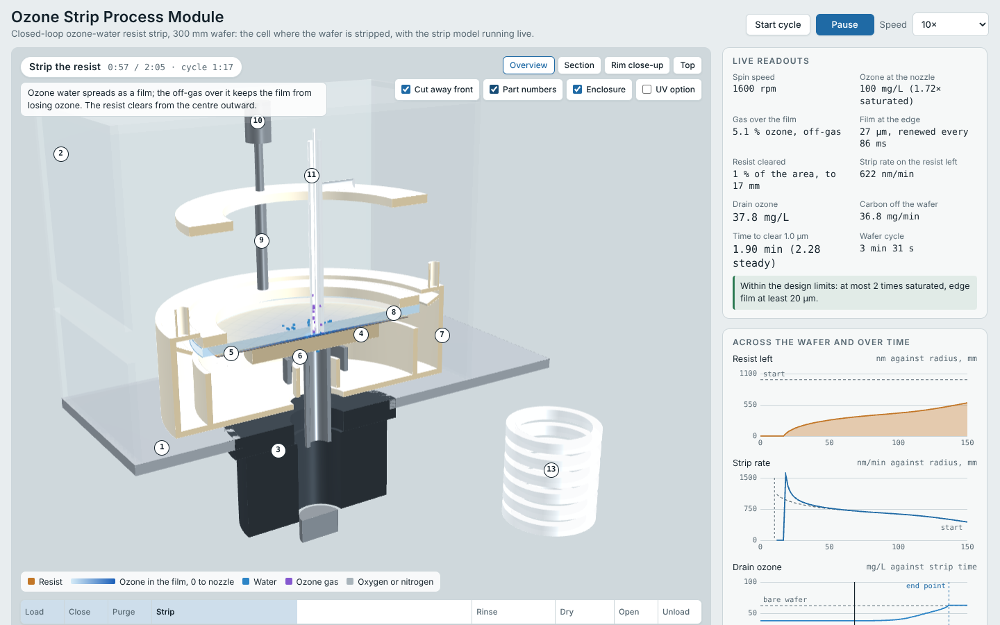
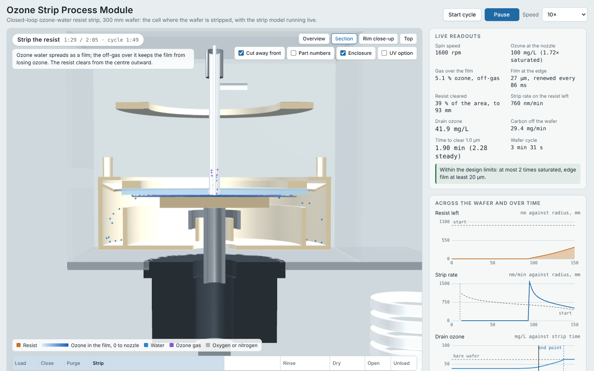

# 3D simulation of the process module

An extra to the project: the cell where the wafer is stripped, as a 3D model in the browser, with
the strip simulated while it runs. The geometry is taken from the CAD model of the module
(`cad/module_cad.py`), the film model is the one of the `dio3` package and of `model.js`.





## What it shows

- **The module**: deck plate, enclosure, direct-drive motor, vacuum chuck, wafer, labyrinth seal,
  rim collector, quartz lid with its lift, coaxial dispenser, the UV option and the heat-recovery
  exchanger. The front can be cut away, parts can be numbered, and a part under the pointer is
  named with its material and its job.
- **One wafer cycle**: load, close the lid, purge, strip, rinse, dry, open, unload. The water film,
  the gas in the gap and the resist are drawn as they change; the resist clears from the centre
  outward.
- **The strip, computed live**: resist left and strip rate across the radius, dissolved ozone in
  the drain against time with the end point, and where the ozone made goes.
- **Settings**: spin speed, water flow, temperatures, pH, gas strength and flow, resist thickness
  and the gas over the film, with two presets: the machine design point and the open process
  without a lid. Every change runs the simulation again.

## How to run it

**In the browser, nothing to install.** Open `simulation/index.html` in a current browser
(double-click the file, or drag it into a window). The page loads three.js and the fonts from the
internet, so the computer must be online. It needs WebGL, which every current desktop and phone
browser has.

If the browser blocks scripts on local files, serve the folder instead:

```bash
cd ozone-wafer-cleaning
python3 -m http.server 8000
# then open http://localhost:8000/simulation/
```

**On the page**

1. The cycle starts in the strip step. `Start cycle` runs it from loading the wafer; `Pause`
   stops it; `Speed` sets 1, 5, 10 or 30 times real time. A click on a step in the bar at the
   bottom jumps there.
2. Drag to turn the model, scroll or pinch to zoom, right-drag to move it. `Overview`, `Section`,
   `Rim close-up` and `Top` are fixed views.
3. `Cut away front`, `Part numbers`, `Enclosure` and `UV option` switch those on and off. A click
   on a part in the parts list flies to it.
4. Under `Settings`, pick a preset or move a slider. The strip is computed again in under a
   second and the cycle restarts at the strip step.

**Rebuild the page** after a change to `template.html`, `core.js` or `app.js` (Python 3, no
packages):

```bash
python3 simulation/build.py     # writes simulation/index.html
```

**Run the checks** of the simulation core (Node.js, no packages):

```bash
node simulation/test.js
```

They compare the time to clear with the steady model, check that the dissolver never takes up
more ozone than the generator makes, and that all the ozone fed to the wafer and all the resist
removed are accounted for.

## What is computed

| Step | Equations |
|---|---|
| Generator gas | Ideal gas law: g/Nm³ to mole fraction |
| Dissolver | Four ideal counterflow stages (Kremser equation) with Henry's law, so it can never dissolve more ozone than the generator makes; 0.90 of equilibrium at the design point |
| Supply line | First- and second-order decay against pH and temperature over the residence time |
| Film | Thickness of a film on a spinning disc, h = (3νQ / 2πω²r²)^(1/3) |
| Ozone in the film | Convection outward, diffusion across the film, decay, exchange with the gas over the film, and uptake at the resist; backward Euler in the radius, Newton iterations, tridiagonal solve |
| Strip | Stepped in time: where the resist is gone the wafer takes up no more ozone, so more reaches the resist further out |

Results at the two presets, for 1 µm of resist on a 300 mm wafer:

| | Machine design point | Open process |
|---|---|---|
| Time to clear, stepped in time (min) | 1.90 | 7.35 |
| Time to clear, steady model (min) | 2.28 | 8.09 |
| Share of the ozone made that reaches the resist | 15 % | 3 % |
| Ozone made per wafer (g) | 0.57 | 2.9 |

The steady model, used in the rest of the project, takes the strip rate of the full resist layer
and the slowest point on the wafer; it is the more cautious of the two. The stepped simulation
follows the clearing front, and is shown here beside it.

## What it is not

It is not a flow simulation (CFD). The film is the one-dimensional film model of the project, and
the water and gas tracers only illustrate the paths. On screen the film is drawn 50 times thicker
and the rotation 30 times slower, so that both can be seen. Like the rest of the project, it is a
model from published equations and data; the machine has not been built.

## Files

| File | Contents |
|---|---|
| `index.html` | The built page, one file |
| `template.html` | Layout, styles and text of the page |
| `core.js` | The simulation: dissolver, supply, film solver, steady and stepped strip. Runs in a worker in the page, and in Node.js for the checks |
| `app.js` | The 3D scene (three.js), the cycle, the charts and the settings |
| `build.py` | Puts `index.html` together; the property and decay functions come from `../model.js` |
| `test.js` | Checks of the simulation core |
| `overview.png`, `section.png` | Screenshots for this file |
